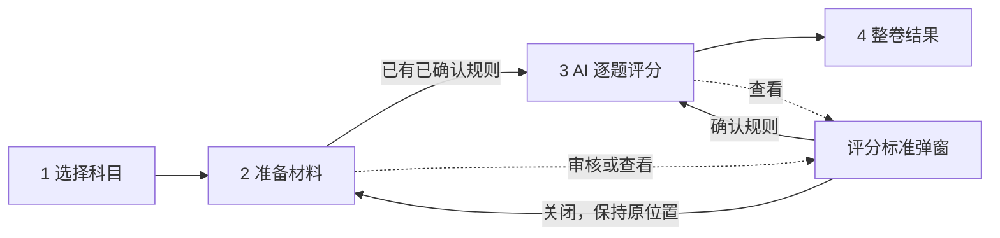

# 科目与考试工作流重构

## 这个 Epic 要改变什么

把当前以“状态总览 + 全局科目上下文 + 独立知识库”为中心的工作台，重构为面向教师任务的四个稳定入口：科目管理、试卷作答、答案评分、复核队列。前后端共同支持科目 CRUD、流程内科目选择、外部答案材料、AI Mark Scheme 草案和跨科目复核；保留现有数学 9660、经济 9640 的全部持久数据，不重建数据库、知识库或向量索引。

## 为什么现在做

当前界面把基础设施健康、领域约束、资料统计和用户任务同时暴露，状态总览、左下科目上下文、独立知识库和流程页面之间层级重复。已有后端能力足以支撑资料、知识、作答和评分，但入口按技术边界组织，导致功能杂乱、主要任务不连续。需要在不损失既有能力与数据的前提下，按教师的实际工作流重切产品和应用边界。

## 关联 Project Spec

- `codestable/spec/index.md`：本 Epic 将改变当前“状态总览 / 独立知识库 / 全局科目上下文 / 只接收系统作答记录和官方 Mark Scheme”的 Web 使用路径；关闭后把已验证的新路径合并回当前真相。
- `codestable/epics/001-o-多科目知识生产与难度证据流水线/spec.md`：继承科目隔离、受控知识版本、证据化作答、人工确认评分和审计边界；用户最新决定覆盖其中关于状态总览与独立知识库入口的旧 UI 方案。

## 当前方案

### 稳定导航

```text
ExamTwin
├─ 科目管理
├─ 试卷作答
├─ 答案评分
└─ 复核队列
```

移除状态总览、独立知识库入口、左下角科目上下文切换、品牌副标题、基础设施状态卡、资料构成、上下文隔离和自动评分说明等非任务信息。后端科目隔离继续保留；作答和评分在各自第一步选择科目后，把选择写入请求上下文。

### 科目管理

科目卡片展示预设图标、固定主题色、名称、代码、资料数、知识点数、向量数和业务状态。新增科目使用宽幅弹窗，科目标识、科目代码、科目名称、课程体系必填；语言使用默认值，能力模板可选。

管理弹窗只保留三个业务面：

```text
基本信息 | 资料管理 | 知识库
```

基本信息只允许修改名称、图标和颜色；科目标识、科目代码、课程体系与能力模板只读。资料管理支持查看、上传、替换和删除。知识库只保留核心/补充知识库版本、输入资料、重新构建和发布状态；现有图谱生产与层级浏览 UI 从产品界面移除，不删除已持久化图谱及后端作答能力。

所有科目均允许物理删除。删除数据库业务数据、对象存储内容和科目专属 Qdrant 集合/别名；运行中任务存在时拒绝删除。内置 SubjectPack 不再随启动自动重建被删除科目，而作为新增科目时可重新使用的能力模板保留。

### 试卷作答

页面默认展示可筛选、查看、单条或批量删除的作答记录；“新建作答”进入三步流程：


步骤三保留持久 Worker、实时进度、逐题答案、引用、图表、来源页和失败重试。只渲染当前步骤，不用空面板提前占位。

### 答案评分



材料路径：

1. 系统作答记录：选择已有记录，自动取得试卷和答案，选择、上传或生成 Mark Scheme。
2. 自行上传：支持试卷与答案分别上传，也支持一个包含题目和答案的合并 PDF / Markdown；解析后先展示题号映射，确认后继续。本 Epic 不支持扫描手写答题卡 OCR。

有官方 Mark Scheme 时继续使用受控上传和审核。没有官方版本时，只有当前科目已经发布课程大纲和核心知识库，才能让 AI 根据课程大纲、知识库和试卷生成标为 `ai_generated` 的评分规则草案；缺少前置资料时阻止生成并引导到科目管理。草案保存模型、提示词版本、来源知识版本和生成时间，教师逐条审核、修改并确认后才能评分，不冒充官方 Mark Scheme。

整卷结果继续使用持久化逐题 assessment 聚合总分、完成度、共性问题、整体建议和逐题建议。AI 结果仍是建议，最终确认进入复核队列。

### 复核队列

移除全局科目切换后，复核队列默认合并展示全部科目的待复核项；每条显示科目，支持按科目筛选。人工确认、改分、最终分范围和审计记录规则不变。

## 界面与交互变化

### 目标界面

- 角色与入口：教师通过固定侧栏进入四个任务页面。
- 图示状态：目标。

```text
┌─ 深墨蓝侧栏 216px ─┬─ 冷灰页面 / 白色业务表面 ───────────────────┐
│ ExamTwin           │ 科目管理                         [新增科目] │
│ ● 科目管理          │ ┌▌ Mathematics 9660 ──────── 可用 ┐       │
│   试卷作答          │ │▌ 资料 456  知识点 227  向量 4975 │       │
│   答案评分          │ │▌                         [管理] │       │
│   复核队列  5       │ └────────────────────────────────┘       │
└────────────────────┴───────────────────────────────────────────┘
```

- 默认浅色“明亮学院管理台”：页面背景 `#F4F6F8`、内容表面 `#FFFFFF`、主文字 `#18202B`、侧栏 `#17212B`、主操作 `#2F6FED`、成功状态 `#16846A`。
- 科目以预设图标、固定主题色和资料夹索引色条识别；流程选择科目后沿用其主题色。
- 页面标题 28–32px；控件 38–40px；卡片圆角 12–14px；弹窗圆角 16px。卡片靠边框分层，阴影仅用于弹窗、菜单和浮层。
- 科目管理弹窗约 1080px / 92vw，标题、标签和底部操作固定，中间独立滚动；移动端全屏。
- 不使用渐变大背景、玻璃拟态、纯装饰指标卡、大量胶囊标签或宣传文案。
- 保留浅色、深色和跟随系统，但三种模式共享同一信息结构。
- 统一使用 Radix Themes 作为完整交互与主题组件体系，Lucide 作为图标体系，Motion 作为动效基础；
  Dialog、Alert Dialog、Tooltip、主题 token、焦点管理和 reduced-motion 由同一设计系统承载，
  不再为同类交互并列引入第二套组件库。

## 架构考量

- 前端壳只拥有导航、主题和全科目目录；业务页拥有自己的科目选择与流程状态。请求层仍集中写入 `X-ExamTwin-Subject`，但必须防止旧科目晚返回覆盖当前流程。
- `subjects` 继续拥有科目生命周期、能力模板和资料归属；新增更新/删除应用服务隐藏数据库、对象存储和 Qdrant 清理顺序。
- `knowledge` 继续拥有资料注册和知识版本构建；移除 UI 不等于删除后端图谱事实或作答检索能力。
- `assessment` 增加可评分提交（系统记录、分离文件、合并文件）和 AI 评分规则来源，统一映射为现有逐题评分输入，避免在评分服务内堆三套分支。
- FastAPI 只处理协议、上传流和错误映射；OpenAPI 是前后端契约单一来源。
- 数据库只做向前兼容 Alembic 迁移，不 drop/recreate、不重跑 inventory、不重建知识库或 Qdrant alias。

## 质量约束与取舍

- 功能适宜性：数学 9660 与经济 9640 必须分别完成科目管理、作答、评分和复核；一科成功不能代替双科成功。
- 交互能力：每页只有一个主要任务；危险删除明确范围并二次确认；加载、空、失败、禁用和长任务进度就近显示；宽幅弹窗具备焦点约束和键盘关闭规则。
- 可靠性：迁移后现有两科的资料、知识版本、向量别名、作答、Rubric、assessment 与复核保持可读；失败清理不能留下半删科目或半写提交。
- 信息安全性：所有科目相关读写继续在服务端校验科目归属；流程内选择只改变客户端请求上下文，不成为授权替代品。
- 可维护性：科目生命周期、提交解析、Mark Scheme 来源与 UI 流程状态各有单一所有者；删除旧导航、旧状态面板和旧调用路径，不留兼容 UI。

## 当前推进

### epic 内直接推进

- 科目生命周期与迁移：增加图标/颜色、更新、全量删除和能力模板行为，保留现有两科数据。
- 科目管理 UI：替换状态总览，整合资料与知识版本构建，删除独立知识库导航。
- 试卷作答 UI：记录管理与三步流程。
- 答案评分模型与 UI：外部材料、合并解析、AI Mark Scheme 草案、四步流程。
- 跨科目复核：合并队列和筛选。
- 视觉收口：明亮学院管理台、响应式和关键状态。
- 双科验收与独立 Agent 核查。

### 2026-08-11 试卷作答故障恢复与详情态收口

- 作答详情与记录列表分离：进入任务后只保留当前科目、文件、步骤和返回入口；解析终止时展示已完成页数、失败页段、原始错误与“从失败步骤继续”，不再渲染无限等待的空结果区。
- MinerU 图片落盘仍以物理页来源为硬门禁；仅当一个多页分块中恰好只有一个 PDF 页面含嵌入图片，且嵌入图片数与未定位引用数一致时，才允许确定性补齐页码。视觉模型连续遗漏已持久化图片时，保留对应物理页的 MinerU 原文并记录低置信度恢复事件，不删除来源图片。
- 子问合并统一把 `4 (a)` 一类模型标签归一为 `(a)` 后去重，主源题号、子问与分值结构校验继续 fail closed。
- 真实任务 `a6d39731-e3fe-438b-b0ec-63ff3db53c88` 断点重试后：原失败页段 11–15 在第 2 次尝试完成，其他已完成页段未重复；32/32 页解析、视觉复核及 8/8 拆分检查点通过，最终 14/14 题完成、0 失败。浏览器实测已显示真实逐题答案、来源页、引用与实时进度，无横向溢出。
- 验证证据：后端相关测试 55 passed，Ruff 与 basedpyright 通过；前端 105 passed，生产构建与 lint 通过；桌面与窄屏真实浏览器冒烟通过。

### 2026-08-11 统一设计系统与评分审核交互收口

- 引入完整 Radix Themes 主题与交互组件体系，配合 Lucide 图标和 Motion 页面动效；全局单一
  DesignSystemProvider 同步浅色/深色主题与系统 reduced-motion，弹窗、危险确认和 Tooltip 不再
  各自维护焦点与遮罩逻辑。
- 工作台统一为苹果式克制表面：系统字体栈、低层级阴影、18–22px 业务表面圆角、单一蓝色强调、
  清晰 hover/focus/pressed 状态；移除误导性的省略号“管理”图标，改用设置图标。
- 评分材料继续留在主页面；评分标准审核成为独立宽幅弹窗，关闭后保持材料或逐题评分原位置，
  确认后才进入逐题评分。删除了“按科目准备答卷与评分标准”等解释性废话，并将保留/排除规则
  与判定学生答案是否得分的动作语义分离。
- 评分细目在仓储返回和前端展示两层都按自然题号、子问与 `M1 → A1 → B1 → M2…` 排列；
  对应后端与前端回归测试覆盖 Q1/Q2/Q10 和乱序输入。
- 科目、资料、最终评分和 AI 临时评分标准等确认动作统一使用可访问 Alert Dialog，替换浏览器
  原生 confirm；评分审核使用 Dialog 的焦点约束和背景隔离，写入期间禁止关闭与流程跳转。
- 实机视觉复核进一步消除 Radix 全局表单样式与科目搜索框的双重边界；390px
  屏宽下主导航改为四等分的图标+文字标签，四个入口均可见且页面无水平滚动。
- 作答记录与 Mark Scheme 都支持不离开材料页的管理弹窗，可搜索、切换当前材料与受控删除；
  两个选择器均以“文件名 + Unit/题数/完成状态或来源/页数/就绪状态”双层展示。真实
  9660 页面复核时发现 Radix 主题容器会把单项菜单撑到整页高度，现已显式收紧为内容高度，
  超过 420px 才滚动，并增加浏览器尺寸回归。
- Mark Scheme 删除失败的根因是前端把后端成功的 `204 No Content` 当成空响应异常，导致已归档
  材料的确认弹窗未关闭，再次点击才返回 404。现已接受 204 成功语义，服务端删除一旦提交，
  前端立即移除该项；如删除当前使用项则 Mark Scheme 选择置空，后续列表/复核队列刷新失败也不会
  把已成功的删除重新报成失败。
- 所有 AppConfirmDialog 共用同一 Alert Dialog 遮罩：28% 深色透明度与 5px 背景模糊，弹出时
  仍能微微辨识后方上下文，但焦点、点击与键盘交互仍只属于确认弹窗。
- 主题切换器只保留一套稳定的 hover/active 样式；根页面尺寸与背景只作用于真正的 Radix Root
  Theme，Tooltip Portal 不再继承整页高度或画布背景；非交互式 Tooltip 也不截获指针事件，悬浮
  后仍可直接点击相邻动作。Mark Scheme 官方文件上传以固定尺寸图标呈现，可见文案收进悬浮提示，
  文件输入继续保留明确的可访问名称。
- 验证证据：前端 16 个 Vitest 文件 / 106 项测试、5 项 Chrome/Playwright 视觉与响应式检查通过，
  ESLint、OpenAPI 生成类型检查、TypeScript 与生产构建通过；后端全量为 418 passed / 19 skipped，
  Ruff check、Ruff format 与 basedpyright 通过。运行态最近一次 9660 P2 作答任务为 32/32 页、14/14 题完成、
  0 题失败。
- 本轮增量回归为前端 16 个 Vitest 文件 / 110 项、6 项 Chrome/Playwright 检查、ESLint、
  TypeScript/Vite 生产构建与 `git diff --check` 全部通过；宿主 5173 前端使用当前源码重启，
  实际数学 9660 数据已验证两个管理入口、双层选择内容与页面无水平溢出。

### 剩余阻碍

无。需求与关键取舍均已由用户确认。

## 暂不推进范围

- 扫描或手写答题卡 OCR。
- 学生账号、班级统计、正式成绩发布。
- 移除已持久化知识图谱或重建现有数学/经济知识数据。
- 修改现有评分最终确认和审计权威边界。

## 关闭条件

- 现有数学 9660、经济 9640 数据经增量迁移后保持完整可读。
- 四个稳定导航和已确认视觉风格在桌面、移动端及主题模式下成立。
- 科目创建、修改、资料管理、知识版本构建和物理删除行为通过验证。
- 数学和经济分别跑通作答三步、评分四步及复核队列；验证无跨科目污染。
- 系统记录、分离文件、合并文件、官方 Mark Scheme、AI 草案及教师确认门禁均有端到端证据。
- UI/UX Agent、代码 Review Agent 和独立全流程 Agent 的问题全部修复并复核通过。
- 相关自动测试、OpenAPI 一致性、生产构建和真实浏览器冒烟通过。

## 合并回 Project Spec 的候选

- 四入口 Web 信息架构与流程内科目选择。
- 科目管理、能力模板和删除生命周期。
- 外部答案提交与 AI Mark Scheme 草案边界。
- 合并复核队列及双科数据隔离。
- 明亮学院管理台的稳定交互原则。
