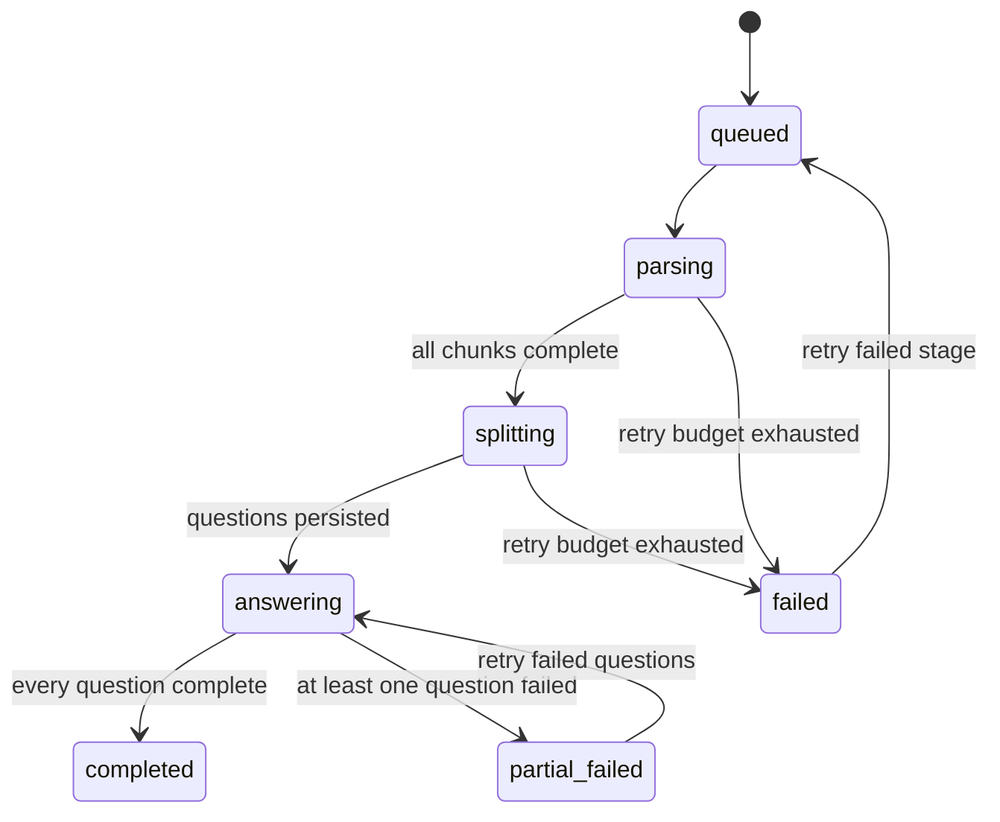
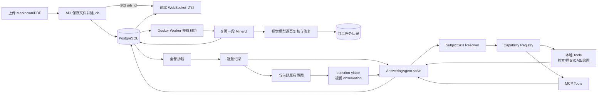

# 整卷证据作答与细粒度知识图谱

## 目标

教师或内容维护者上传一份 9660 试卷后，系统自动识别顶层题目，逐题从知识库检索并作答；
前端在每题答案旁直接展示引用页、知识点和难度依据。知识页不再只展示 Unit/章节平表，
而是能看见 Unit → 章节 → syllabus 学习目标三级从属，以及先修等非从属关系。

## 范围

- 包含：Markdown/PDF 试卷上传、MinerU PDF 转换、顶层题目拆分、逐题 RAG 作答、
  每题引用与知识点映射、细粒度 syllabus 目标节点、层级/关系可视化、持久后台任务、
  分段解析、WebSocket 实时进度、断点续跑、原卷题面页图、答案矢量图、知识库完整原文，
  以及可扩展的答题 Agent 学科 skill / tool harness 与错误/空/处理中状态。
- 不包含：扫描答题卡识别、学生答案评分、正式成绩发布、多用户权限、跨机器自动扩缩容。

## 归属

- 独立 issue。
- 相关 spec：`codestable/spec/index.md`

## 背景与证据

- 当前“证据问答”只接受一段文本问题，不能处理整份试卷。
- 当前知识图谱只有 5 个 Unit、38 个章节节点，前端还是平表；用户明确认为难度和关系过粗。
- 已转换的官方 syllabus Markdown 含逐章节 Content / Additional information 表，可作为细粒度
  学习目标节点的权威来源；推断难度仍必须保持 D 级。

## 现状如何工作

前端把完整文件作为一个同步 HTTP 请求提交。PDF 在请求进程里整份交给 MinerU precision，
成功后再做一次全卷 LLM 拆题，最后最多三题并发执行 embedding、Qdrant、rerank 与回答。
只有逐题阶段具有部分失败保护；PDF 解析和全局拆题任一超时都会让整次请求返回 502。

这个结构把长任务状态交给了短生命周期 HTTP 请求：PostgreSQL 不知道任务存在，前端只知道
“loading”，服务端也没有阶段、页段、心跳或可恢复检查点。上传临时文件在请求结束时删除，
所以同一 PDF 重试必须从零开始。这不是局部 timeout 参数问题，而是状态所有权放错了。

后台任务、分段解析和 WebSocket 已经修正上述长任务边界。逐题作答当前由一题一个有界
ReAct Agent run 执行，可在学科 allowlist 内选择知识检索、精确同卷证据、原文读取、符号/
概率计算、坐标图、几何图和通用图片工具；每次 observation 回到下一步决策，安全步骤摘要
持久化并实时投影。拆题阶段同时产出小问、分值、精度、单位和答案产物要求，运行时据此
动态分配硬上限内的工具预算，并在最终完成前校验小问覆盖、引用和所有必需图形产物。

## 影响范围

- 必须修改：整卷上传 API 契约、PostgreSQL 任务/页段/题目状态、Docker Worker、共享任务目录、
  MinerU 分段解析、整卷编排、前端实时订阅与恢复。
- 需要验证：Markdown/PDF 输入边界、拆题稳定性、每题答案与引用绑定、知识树与关系展示、
  worker 崩溃续跑、重复 worker 抢占、页面刷新恢复、现有单题 RAG/评分接口不回归。
- 仍待调查：真实试卷在 5 页分段下的 MinerU 延迟分布；不同年代试卷题号版式差异。

## UI 变化

- 角色与入口：教师/内容维护者从原“证据问答”入口上传整卷并查看逐题答案。
- 图示状态：目标。

```text
┌─ 试卷逐题作答 ───────────────────────────────────────────────────────┐
│ [拖入或选择 Markdown/PDF] [可选 Unit]                  [提交任务] │
│ 解析试卷：第 16 / 34 页  ███████░░░  · 可离开页面                  │
│ 阶段：已上传 → 分段解析 → 拆题 → 逐题作答 6/14 → 完成/部分失败      │
├──────────────────────┬─────────────────────────────────────────────┤
│ 题目导航              │ 当前题                                     │
│ ● Q1  已作答           │ 题干 Markdown                              │
│ ○ Q2  证据不足         │ ┌─ AI 解答 ─────────────────────────────┐ │
│ ○ Q3  已作答           │ │ 带 [S#] 引用的分步答案                 │ │
│                        │ │ math-diagram 绘制坐标/几何图           │ │
│                        │ └────────────────────────────────────────┘ │
│                        │ [查看原卷 · 2 页]                           │
│                        │ 知识点：P2.7.03 · Integration by parts     │
│                        │ 难度 0.72 · D 级推断                       │
│                        │ 参考证据：[S1] textbook p.22 [完整原文]    │
│ [仅重试失败步骤]       │                                             │
└──────────────────────┴─────────────────────────────────────────────┘
```

- 交互与关键状态：上传成功即返回任务编号；页面按阶段显示页数/题数进度；刷新页面或重新进入
  可恢复最近任务；已完成题目立即可看；失败时显示失败阶段和“仅重试失败步骤”，不要求重传。
- 稳定约束：答案、知识点和引用必须按题绑定；证据不足不得伪装成已作答；题面只显示紧凑的
  “查看原卷”按钮，点击后在可关闭、可滚动的弹窗中展示该题对应页，不把整份 PDF iframe
  或大幅页图直接占据答题阅读流；引用可展开知识库的完整页/章节原文；需要作图的答案必须
  显示经后端校验的结构化矢量图。
- 仅作示意：具体文案、颜色和卡片尺寸。

## 质量目标

- 功能适宜性 / 正确性：
  - 目标：支持的试卷输入至少拆出一个顶层题目；返回顺序与原卷一致，每题结果只引用自己的
    检索证据。依赖图表/空间信息的 PDF 题目作答前必须把该题 `source_pages` 对应的真实页图
    交给视觉模型，并把有界视觉 observation 送入该题 Answering Agent；文本题不做无效的
    整页视觉调用，也不能只依赖预处理阶段的图像文字转述。
  - 来源：用户决定与本次风险扫描。
  - 预期证据：拆题单测、服务/API 测试、真实已转换试卷穿刺。
- 交互能力 / 易操作与自描述性：
  - 目标：用户能从单页完成选卷、等待、逐题切换和查看答案/知识/证据；空、忙、失败、
    证据不足状态可区分。
  - 来源：用户决定。
  - 预期证据：生产构建与真实页面路径检查。
- 可靠性 / 容错性：
  - 目标：HTTP 断开、页面刷新或 worker 重启不丢失已解析页段和已完成题目；重试只执行失败
    或未完成步骤；单题作答失败不影响其他题结果。
  - 来源：本次风险扫描。
  - 预期证据：worker 中断/租约过期/续跑集成测试，真实 PDF 失败后重试穿刺。
- 性能效率 / 时间特性：
  - 目标：上传接口只负责持久化和建任务，数秒内返回 202；长耗时留在 worker，用户持续看到
    已完成页数和题数，而不是等待一个无反馈的 HTTP 请求。
  - 来源：真实十几分钟超时投诉。
  - 预期证据：API 响应计时、分段进度观察、完整试卷端到端时序记录。
- 可维护性 / 可测试性：
  - 目标：任务状态转换由单一模块拥有；解析、拆题、逐题 RAG 作为可重试阶段，云端依赖可
    注入测试替身；前端只消费任务投影，不复制状态规则。答题 Agent 对外只暴露一个稳定的
    `solve(task) -> result` 能力，学科 skill、本地 tool 与 MCP tool 经统一能力注册表组合，
    不让各科在 RAG 服务和 Worker 中复制编排逻辑。
  - 来源：本次风险扫描。
  - 预期证据：状态机/抢占测试、Agent 循环与能力策略测试、服务级测试、Ruff、
    TypeScript 构建。
- 可靠性 / 可恢复性与可分析性：
  - 目标：每个答题 Agent run 有最大步数、总时限、工具调用预算和取消边界；本地或 MCP
    工具失败时记录可恢复的 step 事件，不暴露模型隐式思维链，前端可看见“检索 / 计算 /
    作图 / 校验”等安全进度摘要。
  - 来源：多学科扩展和既有 provider timeout 风险。
  - 预期证据：超预算终止、工具超时/重试、Worker 接管、WebSocket step 投影测试。

## 风险与穿刺

- 风险表与顺序：
  1. MinerU 后的真实试卷是否可稳定拆出顶层题号；
  2. 每题检索/作答的成本和部分失败返回；
  3. syllabus 表格能否稳定同步为细粒度节点；
  4. 关系与难度能否在前端可读，而非换一种平表。
- 主路径打通标准：上传一份真实 9660 试卷，API 返回多题有序结果，前端可逐题看到答案、
  知识点和来源证据。
- 每点验证与结果：
  1. 三份真实已转换 QP 显示题号可能在普通段落、标题或 HTML 表格中，且个别顶层题号会被
     MinerU 漏掉；因此采用一次结构化 LLM 拆题，正则只用于知识匹配，不承担试卷结构真相。
  2. 两题 Markdown 真实请求通过，拆题后最多三题并发；服务按原顺序汇总，单题异常降级为
     该题失败对象。
  3. 当前官方 syllabus Markdown 成功提取 212 个学习目标，编码在父章节下稳定生成。
  4. PostgreSQL 实际形成 255 条 `contains`、72 条 `prerequisite_of` 和 174 条
     `syllabus_sequence`；前端改为可下钻树与节点关系详情。
- 主路径是否端到端通：真实 24 页 P1 PDF 已端到端通过。上传接口在 0.040 秒返回 202；
  5 个 MinerU 页段约 68 秒解析完毕；`qwen3.6-flash` 约 40 秒拆出 10 道顶层题；10 题
  全部完成、0 失败，每题保存 6 条引用和 3–4 个知识点。穿刺中主动终止旧 Worker 后，
  新 Worker 复用了全部已完成页段，各页段 `attempts` 保持 1。
- 已触发升级条件：完整试卷在同步请求中等待十几分钟后以 provider timeout 失败，且没有
  进度、检查点或可重试任务。因此 Docker 后台任务、PDF 分段检查点和前端进度恢复已经是
  本 issue 的必做范围，不再是“以后频繁超时时再做”的可选加厚项。

## 实现设计

### 这次要怎么做

把整卷处理从 FastAPI 请求中移出，改成 PostgreSQL 持久任务和独立 Docker Worker。API 只校验
上传、把源文件写入共享任务目录、建立任务并返回 `202 + job_id`。Worker 领取任务后按 5 页
一段调用 MinerU，每段 Markdown 成功即落盘并更新进度；全部页段完成后才执行全卷拆题，再把
每道题作为独立可重试项逐步作答。

不引入 Redis/Celery：当前单机低并发下，PostgreSQL 已能用 `FOR UPDATE SKIP LOCKED` 安全
领取任务，新增消息基础设施不会消除 MinerU 超时风险。未来出现多机 worker、弹性扩容或
PostgreSQL 轮询压力时，再把“领取任务”这一层替换为专用队列；任务状态和结果仍以数据库为
真相。

### 功能 / 责任怎么分工

- `PaperJobService`：唯一拥有任务状态转换、进度投影、失败和重试规则；API 和 Worker 都只能
  经它改变状态。
- `PaperWorker`：领取带租约的任务，依次运行解析、拆题和逐题作答；不拥有长期状态。
- `PaperParser`：用 pypdf 把 PDF 切成实际 5 页小文件，调用 MinerU，并为每段写独立检查点。
- `PaperVisionReviewer`：把每个 MinerU 页段与同范围的 PDF 页面图交给视觉模型逐页核对，
  恢复漏字、题号、子题、公式、表格、图形描述和分值；校正 Markdown 与审计 JSON 分开
  缓存，低置信或供应商失败自动重试，已完成页段不重复计费。
- 现有 `PaperAnswerService`：收窄为“已解析 Markdown → 拆题与逐题作答”的阶段实现，不再
  管理上传临时文件和 HTTP 生命周期。
- `answering_agent`：独立的线上答题 Agent Runtime，对 Worker 只暴露
  `solve(AnswerTask) -> AnswerResult`。内部拥有 Agent 循环、能力注册、学科策略、执行预算、
  事件轨迹和最终结果校验；现有 Harness 将被替换，而不是继续叠加 prompt wrapper。
- `answering_agent/subjects`：保存仓库受控的学科 skill。skill 是“适用科目 + 解题政策 +
  证据政策 + 允许能力 + 停止条件 + 输出要求”，不是一段孤立 prompt，也不是 Codex 的
  `.agents/skills`。首个 skill 为 `mathematics-9660`，后续物理、化学等各自注册。
- `answering_agent/capabilities`：统一 `AgentTool` 端口和 `CapabilityRegistry`。本地 Python
  tool 与 MCP 暴露的远程 tool 都归一为带输入/输出 schema、超时、重试、权限和结果大小限制
  的能力；学科 skill 只引用能力名，不知道传输细节。
- `answering_agent/tools`：进程内可信工具。9660 首批为知识检索、完整原文读取、受限 SymPy
  计算/校验、`question-vision` 和 `math-diagram`。`question-vision` 只能读取 Worker 按
  `source_pages` 绑定到当前题的可信 JPEG，使用已配置的视觉模型生成有界 observation；
  绘图工具执行后返回白名单矢量场景，前端只展示通过 schema 校验的图元。
- `answering_agent/mcp`：MCP client/provider 适配层，负责发现远程工具、转换 schema、健康
  检查和调用；MCP 只是能力来源，不拥有学科策略或 Agent 循环。没有进入 skill allowlist 的
  MCP tool 不可被模型调用。
- `answering_agent/traces`：记录 run/step、工具名、脱敏参数摘要、耗时、状态和产物引用，
  供 WebSocket 进度与故障诊断使用；不保存或展示模型的隐式思维链。
- `source_context`：按引用文档 ID、页码或知识标题读取已转换 Markdown 的完整页/章节；
  前端展开引用时按需加载，不把 360 字符检索摘要冒充完整原文。
- PostgreSQL：保存任务、页段和题目状态；同一个失败阶段只能被一个有效租约提交。
- `var/paper-jobs/{job_id}`：保存源文件和页段 Markdown，通过 Docker bind mount 供 API 与
  Worker 共享；数据库只保存相对对象键，不保存宿主机绝对路径。

### 状态所有权与转换协议



Worker 在短事务内以 `FOR UPDATE SKIP LOCKED` 领取任务并写入随机 `lease_token` 与
`lease_expires_at`，然后在事务外调用 MinerU/LLM。每次提交结果时必须带原 lease token 做
条件更新；旧 worker 超时后即使晚到，也不能覆盖新 worker 的结果。worker 崩溃后租约过期，
下一个 worker 从数据库中第一个未完成页段或题目继续。

### 请求 / 数据 / 调用怎么走



### 答题 Agent 内部状态与能力协议

每道题建立一个独立 `AgentRun`，按
`prepare → decide → tool_call → observe → verify → finalize` 循环。`decide` 可以直接结束，
也可以选择当前 skill 允许的一个工具；工具结果作为 observation 回到下一步，直到形成
`AnswerResult` 或触发步数、时限、取消、证据不足等停止条件。外层 `PaperJobService` 仍只
关心该题 `queued / answering / completed / failed`，不接管 Agent 内部决策。

PDF 题目的原卷页图不是模型可选读取的普通证据：Worker 从安全的任务目录按该题
`source_pages` 生成有界 `QuestionImage`，Runtime 在主推理前强制执行一次
`question-vision`，把视觉模型基于真实像素得到的 observation 放入 ReAct reasoning。视觉
调用失败即让当前题失败并由既有逐题重试接管；Markdown 题没有可信图片资产时不伪造调用。

当前模型适配器显式设置 `is_function_calling_model=False`，所以第一版由
`LlamaIndexReActRunner` 使用 LlamaIndex 的 ReAct formatter/parser、LLM 与 `FunctionTool`
抽象运行确定性的有界工具循环；如果后续验证某个云模型端点稳定支持原生 tool calling，再
增加 FunctionAgent runner，`AgentTool`、skill 和结果契约不变。实装穿刺发现当前锁定的
`llama-index-core 0.14.23 + llama-index-workflows 2.22.2` 中，`AgentWorkflow` 会在第一次
LLM 调用前停在 runtime `wait_receive`，超时与取消也无法可靠收束，因此没有把这一框架故障
带进生产链路。MCP tool 仍通过 LlamaIndex 适配为 `FunctionTool`；项目在自己的
`CapabilityRegistry` 处实施学科 allowlist、预算和审计，避免框架类型泄漏到业务层。

最终答案现在单独经过结构化边界：ReAct 仍负责“决定 / 调工具 / 吸收 observation”，一旦
进入结束路径，由 LiteLLM 向当前 OpenAI-compatible 解题端点发送
`response_format=AgentFinalPayload`，供应商按 JSON Schema 约束生成，服务端再用 Pydantic
严格校验。公开契约只含 Markdown 答案、引用编号、置信度、grounded 和警告；LiteLLM 返回的
`reasoning_content` 不参与结果，任意额外字段也被拒绝。后端还会把答案中的 `[S#]`、
`citation_ids` 与本题真实检索结果交叉检查，模型不能仅靠声明把答案标成 grounded。结构化
调用失败后，同一 Agent run 只切换一次到既有 JSON/ReAct 兼容恢复；供应商调用和外层总预算
均有上限，题级持久重试仍由 Worker 负责。

对外结果保持一份稳定的 `AnswerResult`：Markdown 答案、引用、知识点、结构化图或其他产物、
grounded/confidence、警告和可公开的 step 摘要。未来化学结构式、物理受力图、统计图等都作为
artifact/tool output 扩展，不为每个学科改 Worker 与前端主状态机。

### 哪些边界不碰

- 保留原 `/rag/ask` 契约供内部复用和兼容；不把试卷答案写成正式评分。
- 不把章节或目标的推断难度升级为官方难度证据。
- 任务文件不进入长期课程语料和 Qdrant；完成或终止后按保留策略清理。
- 不用 FastAPI `BackgroundTasks`：它仍绑定 Web 进程，重启即丢任务，不能提供租约和续跑。
- 不通过无限调大 timeout 解决外部依赖不确定性。
- 不用正则表达式判断或修复试卷结构完整性；正则只允许承担非结构性的界面提示。PDF 结构
  真相由原页图视觉复核、校正 Markdown 和后续结构化拆题共同建立。
- 不执行模型返回的任意 SVG、HTML、脚本或 base64；`math-diagram` 只接受白名单图元、数值
  几何和受限 path 命令，文本由 React 转义后进入浏览器原生 SVG。
- 不把“Agent 化”理解成无上限自主运行或先做多 Agent 协作。当前正确粒度是一题一个有界
  Agent run；拆题、视觉复核、评分仍是具有各自权威边界的服务。
- Skill 不能直接携带任意可执行代码或自行连接外部服务；它只能选择已注册能力和声明政策。
  本地 tool 与 MCP tool 均需服务端配置、schema 校验、allowlist、超时和结果限额。
- 解题与评分使用不同 skill/能力政策：解题 Agent 不能把自动答案直接写成最终评分；评分仍
  必须依赖严格配对的 Mark Scheme 并进入人工复核。

### 有界简化

- Compose 默认两个 Worker；每份试卷仍只由一个租约 Worker 持有，单卷内部逐题并发上限为
  4。供应商限流由题级有界重试和独立模型预算处理，不让两个 Worker 共同写同一任务。
- 共享目录适用于当前单机 Docker Compose。需要多机 worker 或对象跨主机共享时，升级方向是
  把对象键后端替换为 Docker MinIO/S3；任务状态机与 API 不变。
- PostgreSQL 轮询适用于当前低并发。需要弹性 worker、优先队列或可观察到数据库轮询成为
  瓶颈时，再替换为 Redis/Celery；不提前购买这套复杂度。
- 题面视觉当前使用原 PDF 页图保证可核对性；MinerU Markdown 中的图片引用若没有持久资产，
  不伪装成可用。解题阶段暂时把该题少量完整页 JPEG 交给视觉模型，不提前实现题区 bbox；
  以后 MinerU 能稳定返回图片包和 bbox 时，由同一 `QuestionImage` 资产边界改为题目级裁剪，
  `source_pages` 与前端契约不变。

### 一步步怎么改

1. 先新增任务/页段/题目表与纯状态转换模块，写并发领取、租约过期和条件提交测试。
2. 把 PDF 解析抽成 5 页分段与检查点，使用假的 MinerU 验证“第二段超时后只重试第二段”。
3. 增加 `paper-worker` CLI 和 Docker Compose Worker，共享任务目录并验证进程重启续跑。
4. 把上传接口改为 202 建任务，增加任务查询和“仅重试失败步骤”接口。
5. 收窄现有同步整卷服务并接入阶段结果；逐题完成一题写一题，不等全卷后一次提交。
6. 前端改为 job_id 驱动，通过 WebSocket 接收阶段与计数，刷新后恢复，并逐步显示已完成题目。
7. 最后用同一份曾超时 PDF 回归：必须在解析过程中看到页数增长；人为中断 worker 后重启，
   已完成页段不得重新调用 MinerU。
8. 将当前 `AnswerTool` 从“提示词 + 输出校验”重切为可执行 `AgentTool`，新增稳定的
   `AnswerTask / AnswerResult / AgentStep` 契约与能力注册表；保留现有 RAG 结果作为基线。
9. 把知识检索、完整原文读取、SymPy 校验和数学绘图做成首批本地工具；用假的模型决策器证明
   同一道题可以“检索 → 读原文 → 计算/作图 → 最终回答”并且每步可重试、可终止。
10. 用 `LlamaIndexReActRunner` 接管有界循环；当前非原生 function-calling 模型走显式
    `decide → tool → observation → decide`。跑固定 9660 小题集，对比当前单次 RAG 基线，
    确认工具循环确实提高完整性或可核查性后再扩展 runner。
11. 增加 MCP provider 适配器和 fake MCP server 契约测试；生产环境只有配置并被学科 skill
    allowlist 引用的 server/tool 才加载，不因安装适配器默认开放网络能力。
12. 把公开的 Agent step 摘要并入现有 PostgreSQL/WebSocket 任务投影；前端显示当前题正在
    检索、计算、作图或校验，不展示隐式思维链。

### 怎么确认做对

关键验收不是“最终某次跑完”，而是失败可恢复：

- 上传接口在长任务开始前返回 202，浏览器网络请求不保持十几分钟。
- MinerU 第二页段故意超时，任务显示失败页段；重试时第一段调用次数保持一次。
- Worker 在外部调用中被终止，租约过期后新 Worker 接管；旧 Worker 晚到不能覆盖新状态。
- 页面刷新后用 job_id 恢复进度；已完成题目立即可看。
- 同一份真实 PDF 完成或部分失败时，前端能指出阶段、页段/题数和可执行的重试动作。
- 一道需要计算与作图的 9660 题能产生至少一次真实工具调用；工具 observation 参与后续回答，
  而不是由同一次 LLM 响应伪造 `diagrams` 字段。
- 禁止的工具、越权 MCP tool、非法参数、超时、超步数和超结果大小都被 Agent Runtime 拒绝，
  失败只影响当前题并留下安全的 step 摘要。
- 新增一个 fake 物理 skill 时，只需注册学科政策和能力，不修改 `PaperWorker`、
  `PaperJobService` 或 Agent 主循环，以此验证多学科接缝真实成立。
- 普通测试不接触真实密钥；真实 PDF smoke 单独标记并记录 MinerU、拆题、逐题各阶段耗时。

## 验证

- 2026-07-30 MinerU 整表原子化：扫描 216 个 Markdown 缓存、2,622 个表格块，逐表经过
  页码/标题分段与索引节点生成后 0 个缺失或拆分；去除 7 个大 PDF 分段缓存副本后，在线
  209 份文档重建为 9,511 个 Qdrant 点，其中 2,391 个为完整表格节点。最大表 70,724 字符、
  290 行，在线 `_node_content` 与 MinerU 缓存逐字一致且完整保留 `<table>...</table>`。
  PostgreSQL 同步生成 12,947 条非定义知识证据；真实 syllabus RAG smoke 返回 HTTP 200、
  `grounded=true`、2 条可定位官方引用。全量后端 `58 passed, 8 skipped`，Ruff 通过，
  前端 TypeScript/Vite 生产构建通过。
- 2026-07-30 Answering Agent Runtime：后端 Ruff 通过；Agent 专项 `8 passed`，覆盖真实
  ReAct 两轮“检索 → observation → 最终答案”、工具 schema 可序列化、证据不足降级、
  阻塞工具硬超时、非法 SVG path 拒绝、MCP allowlist/结果包装和新增学科不修改 Worker。
  非集成测试除当前
  沙箱内依赖跨线程唤醒而挂起的两个 Starlette `TestClient` 用例外 `24 passed`；这两个接口
  已由既有真实 Docker HTTP/WebSocket 验证覆盖，未伪报为本轮通过。
- 连接本机 Docker PostgreSQL 的页段失败/续跑集成测试通过，确认 Agent step 以
  `job_id + question_position + run_attempt + sequence` 持久化，并随任务投影返回。
- `./node_modules/.bin/tsc -b` 与 `./node_modules/.bin/vite build` 通过；前端当前尝试只展示
  安全步骤摘要，题目导航同步显示最近一次检索/计算/作图/校验状态。
- Docker API/worker 已重建；健康端点为 `2026-07-30.answering-agent-v1`，明确声明
  `answering_agent_v1`、`answering_tools_v1`、`answering_mcp_v1` 与
  `paper_agent_steps_v1`。真实 WebSocket 连接收到 completed 权威快照，当前任务含 26 条
  跨尝试步骤，最后阶段为 `finalizing`。
- 真实一题 Markdown 穿刺任务 `09fe2b80-dbc9-4fcb-809c-27bc088ae794` 最终
  `completed 1/1`。修复后的有效 run 调用 `knowledge_search` 两次，把 observation 送回模型，
  保存 10 条公开步骤、5 条官方引用和学习目标 `P1.1.O04`，约 55 秒完成并给出正确的
  `b^2-4ac`、`b^2-4ac>0`。模型首次 ReAct 格式异常只失败当前尝试，自动重试后成功。
- 首次真实穿刺还暴露本地工具嵌套函数的 `Literal` 前向注解无法生成 JSON schema；改为
  显式 `MathCalculateInput` 后新增 schema 回归并重跑成功，避免只在 mock 调用中“看起来可用”。
- 2026-07-30 答题 Agent Harness 与可视证据加厚：后端 Ruff 通过；新增 Harness/不安全
  path 拒绝、完整原文双页码标记、答案图与题面页投影、PDF 页图缓存测试；隔离 PostgreSQL
  的全量测试通过；TypeScript 编译与 Vite 生产构建通过。
- 2026-07-30 WebSocket 实时进度：`uv run ruff check backend/src backend/tests` 通过；
  非集成测试 `17 passed`；连接隔离 Docker PostgreSQL `examtwin_test` 的纸张任务集成测试
  `7 passed`，
  包含真实表触发器 → `LISTEN/NOTIFY` → WebSocket 初始/变化快照的完整往返；
  `pnpm build` 通过。前端已无 2 秒进度轮询，Vite 开发代理显式启用 WebSocket。
- `uv run ruff check backend/src backend/tests`：通过。
- 隔离真实密钥并连接本机测试 PostgreSQL 后运行 `uv run pytest -q`：23 passed；覆盖
  syllabus 目标提取、上传边界、有序逐题作答、单题部分失败、租约过期接管、旧租约拒写、
  MinerU/视觉页段检查点重试、视觉供应商自动重试、低层页面图输入、答题横线清理、只有
  两条真实并发槽显示为 `answering`、HTTP 上传必须返回 `202 + job_id`，以及数学 LaTeX
  反斜杠的结构化 JSON 恢复。
- `./node_modules/.bin/tsc -b && ./node_modules/.bin/vite build`：通过。
- `uv run examtwin init && uv run examtwin stats`：知识节点 256、关系 501。
- PostgreSQL 分解核对：5 Unit、38 topic、212 learning objective；255 contains、
  72 prerequisite、174 syllabus sequence。
- 本机 API：stats、P2 知识节点、OpenAPI 新路径均返回 200；两题真实 multipart 整卷作答
  返回 200。
- 真实 PDF 穿刺：24 页 2025 P1 上传在 0.040 秒返回 202；24/24 页、10/10 题完成，0 失败；
  每题 6 条引用、3–4 个知识点；主动终止 Worker 后续跑时 5 个页段均未重做。
- 2026-07-30 运行态回归：旧宿主机 Uvicorn 被确认占用 `8000`，健康响应不含
  `paper_jobs_v1`，且用户上传没有建立 PostgreSQL job；由同一 uv 锁定镜像启动的 Docker
  API 接管后健康检查为 `healthy`，响应包含 `2026-07-30.paper-jobs-v1`。
- 一题真实 HTTP 回归上传在 0.022 秒返回 202。首次拆题暴露模型 JSON 中 LaTeX
  `\(` / `\frac` 的非法或歧义转义；修复后原任务只重试失败阶段并完成 1/1 题、0 失败，
  保留原 LaTeX，返回 1 个学习目标和 6 条引用。该合成题因没有同题证据而
  `grounded=false`，只证明任务与证据链完成，不把它当答案质量验收。
- 模型实时枚举显示端点提供 `qwen3.6-flash`、`qwen3.7-plus`、`qwen3.7-max` 等；旧
  `qwen3.7-plus` 拆题超过 5 分钟未返回，改用独立 `qwen3.6-flash` 后约 40 秒完成。
- 部署后真实任务 `717e8232-d76c-4798-b942-67a2330c689c`：24/24 页生成 5 组视觉
  Markdown/JSON 检查点，记录 37 处校正，页段置信度 0.95–1.00；结构化拆出 10 题，第 6 题
  完整包含 (a) 5 分与 (b) 4 分且没有正则缺题误报。随后 10/10 题作答完成、0 失败；第 2 题
  首次 `TypeError` 后在第二次自动尝试成功。最终镜像切换后 API healthy，任务结果仍为
  completed，证明结果持久化未受容器替换影响。
- 2026-07-30 原文缓存与知识卡回归：`test_source_context.py` 7 passed、定向 Ruff 与 Compose
  配置检查通过，前端 TypeScript/Vite 生产构建通过。重建 API/Worker 后两者分别为 healthy /
  running；原 404 文档、另一现场文档和最近 completed 任务的 5 个唯一引用合计 7/7 次
  context 请求返回 200，原文均非空、0 个 404。知识卡用长 breadcrumb 与公式关系标题完成
  SSR/KaTeX 检查，并在 1206px、800px 两档 headless Chrome 截图中确认无覆盖、无横向溢出，
  不再把应用顶栏的固定高度施加到卡片内部 header。
- 2026-07-30 结构化最终答案回归：先直接向当前 `qwen3.7-plus` 端点发送 strict JSON Schema
  请求，HTTP 200 且四个字段全部符合约束；再走真实
  `LiteLLMFinalAnswerProvider → response_format=Pydantic → model_validate_json`，返回
  `answer_markdown=2`、`citation_ids=["S1"]`、`grounded=true`。完整一题真实 Agent smoke
  先执行 `knowledge_search`，随后结构化完成判别式答案，得到 1 条服务端引用、
  `grounded=true`、0 警告，公开结果不含 draft 中的 `Thought:`。`uv run pytest -q` 为
  96 passed、8 skipped；`uv run ruff check backend` 通过。这里只验证当前工作区和真实云端
  调用，尚未重建或部署 Compose 服务。
- 2026-07-31 逐题失败与并发回归：非集成全量测试 `120 passed, 10 deselected`，连接本机
  Docker PostgreSQL 的任务/租约/WebSocket/自动重试/三题并发集成测试 `8 passed`，Ruff
  通过，前端 TypeScript 与 Vite 生产构建通过。Compose 解析确认默认
  `paper-worker replicas=2`。真实 `qwen3.6-flash` 单页视觉结构化 smoke 在 3.5 秒内返回
  597 字且通过 `QuestionVisionPayload`；首次 smoke 暴露该端点把结构化结果放入
  `reasoning_content` 而 `content` 为空，修正后仅视觉适配器允许提取并校验该字段，公开最终
  答案边界继续禁止使用 reasoning 字段。当前代码和配置尚未重建部署到运行中的 Compose。
- 2026-07-31 部署确认：Compose 当前运行 1 个 healthy API、2 个 paper worker、healthy
  PostgreSQL 与 Qdrant；Worker 实际配置为单卷 `paper_question_concurrency=4`、题级最多
  3 次自动尝试、Agent 总预算 180 秒。API 健康契约为
  `2026-07-31.answering-agent-v4`，已声明 `selective_question_vision_v1`、
  `paper_question_concurrency_v1` 与 `structured_answer_output_v1`。本轮定向回归
  `85 passed, 8 skipped`，Ruff、TypeScript 与 Vite 生产构建通过。最近任务的第 8 页原卷
  接口返回完整 `1072×1516` JPEG；当前前端只通过小按钮打开单页切换弹窗，不再在答案正文
  中纵向铺开多张整页图。上述证据确认新版本已部署，但本轮没有再次发起付费的完整真实 PDF
  作答，因此 v4 的整卷答案成功率仍需由下一次用户上传实测确认。

## 执行记录

- 2026-07-29：按用户最新产品方向建立常规 feature issue，完成现状、UI 和穿刺设计。
- 2026-07-29：新增整卷作答深服务与 multipart API；Markdown 直接读取，PDF 经 MinerU，
  LLM 恢复顶层题目并映射知识代码，逐题复用现有 RAG，最多三题并发且保留部分失败。
- 2026-07-29：知识同步从官方 syllabus 表格生成学习目标层，显式写入从属和大纲顺序关系；
  目标难度采用章节基线加认知词修正，限制在 `[0,1]` 且保持 D 级、0.3 置信度。
- 2026-07-29：前端将“证据问答”替换为试卷上传、处理状态、题目导航、分步解答、知识难度
  和引用证据；知识页从平表改为层级树与关系详情，并补窄屏堆叠。
- 与设计偏差：没有采用纯正则拆题；真实 MinerU 输出证明题号不稳定，结构化 LLM 是当前
  更可靠且最小的正式骨架。首次穿刺曾保留同步请求，完整 PDF 超时证据随后推翻了该简化，
  当前已改为 PostgreSQL 持久任务与独立 Worker。
- 2026-07-29：同步请求的有界简化被完整 PDF 超时实证推翻。现场检查显示 PostgreSQL、
  Qdrant 与 Uvicorn 存活，但没有活动数据库请求，也不存在独立 paper worker；失败请求结束
  后不会继续执行。设计升级为 PostgreSQL 持久任务、Docker Worker、5 页分段检查点和按题
  结果持久化。
- 2026-07-29：补齐任务查询中的页段投影，前端可直接指出失败页范围和尝试次数；修复失败
  重试后数据库 `stage` 未回到 `queued` 的状态不一致，并让进度条按解析/拆题/逐题阶段真实
  前进。
- 2026-07-29：把整卷结构抽取从通用 `qwen3.7-plus` 分离到 `qwen3.6-flash`，使用独立
  90 秒超时与一次重试；结构模型只负责拆题，数学答案仍使用 `qwen3.7-plus`。
- 2026-07-29：逐题并发状态改为在线程真正取得执行槽时才写 `answering`，避免 10 道题
  全部显示正在作答而实际只有两题运行；增加 PostgreSQL 集成回归。
- 2026-07-29：真实 24 页 P1 穿刺成功。上传 0.040 秒返回；MinerU 5 段约 68 秒；旧拆题
  Worker 被主动终止后，新 Worker 复用检查点并在约 40 秒完成 10 题拆分；最终 10/10 题
  grounded 完成，0 失败。完整流程从新 Worker 接管到完成约 6 分 31 秒。
- 2026-07-30：同一超时报错再次出现时，数据库没有新增任务，现场 `8000` 仍由 7 月 29 日
  启动的旧同步 Uvicorn 占用；当前代码中已不存在 `Paper answering provider error` 文案。
  停止精确识别出的旧进程后，把 FastAPI 纳入 Compose，并让 API 与 Worker 复用同一个
  `examtwin-python:local` uv 锁定镜像。API 健康检查除 HTTP 200 外还校验
  `paper_jobs_v1`，避免旧 API 被误判为可用。
- 2026-07-30：结构模型输出的数学 Markdown 可能在 JSON 字符串中包含未双写的 LaTeX
  反斜杠；共享 JSON 解析器现在只修复字符串内的 LaTeX 转义并保留合法 JSON 换行、引号和
  Unicode 转义，补充回归后同一失败任务成功拆题并作答。
- 2026-07-30：运行中重启 Worker 的现场回归显示 300 秒租约会造成最多约 5 分钟无进度等待。
  单机默认租约收窄为 60 秒、每 20 秒心跳续租；长供应商调用仍保持所有权，进程异常退出时
  新 Worker 最多约一分钟后接管。
- 2026-07-30：最新 24 页真实 P1 任务虽显示 10/10 完成，但第 6(a) 被 MinerU 漏成孤立公式，
  文本恢复附录和文本拆题模型仍未补回。新增 `PaperVisionReviewer`：用 PyMuPDF 将每个 5 页
  页段渲染后交给已验证支持图片的 `qwen3.6-flash`，逐页校正 MinerU Markdown，保存
  `.vision.md` 与 `.vision.json` 检查点，供应商/JSON/低置信失败最多自动重试三次。
  同一真实卷穿刺的 5 个页段共报告 34 处校正、置信度 0.98–1.00；再次结构化拆题仍为
  10 道，且第 6 题完整恢复 (a) 5 分与 (b) 4 分。删除原先按 `(a)/(b)` 正则猜测缺题的
  结构警告，避免对无显式 (a) 标签的合法题型误报。视觉复核开启时不再追加旧 PDF 文本层
  恢复附录，避免重复文本干扰视觉结果；该附录只作为视觉功能关闭时的回退。视觉模型偶尔
  仍会保留答题横线，因此在视觉模块内按整行字符约束删除纯 `Answer ____` 脚手架，不用
  正则推断题号、子题或内容结构。
- 2026-07-30：按用户决定把前端 2 秒进度轮询替换为 WebSocket。PostgreSQL 表触发器通过
  `LISTEN/NOTIFY` 把 API 与独立 Worker 的任务变化送入统一事件通道；WebSocket 每次推送
  完整权威任务快照，首次连接、断线重连和页面刷新都会先补当前快照。前端抽出可复用的任务
  订阅模块并显示连接/重连状态；保留 `GET job` 作为诊断和兼容接口，不再由页面定时调用。
- 2026-07-30：用户纠正“skill”应属于线上答题 Agent，而不是 Codex 开发技能。撤回刚生成的
  `.agents/skills/math-diagram`，新增运行时 `answering_agent`：`SubjectSkill` 选择科目政策，
  `AnswerTool` 注册可执行能力，Harness 统一拼接工具契约并验证输出。9660 的
  `math-diagram` 产出白名单矢量场景，前端原生 SVG 展示；模型生成的任意 SVG/HTML 不进入
  DOM。拆题结果新增 `source_pages`，前端逐题直接显示按需缓存的原卷 JPEG 页图，完整 PDF
  只保留兜底链接。知识点引用和检索引用可按文档 ID 加载已转换教材/大纲的完整页或章节，
  不再只显示 360 字符摘要。
- 2026-07-30：再次核对后确认上述 `answering_agent` 仍只是单轮 prompt / 输出校验 Harness，
  `AnswerTool` 没有执行方法，`RagService.ask` 仍一次性完成检索和 LLM 生成，不能称为真正的
  工具使用 Agent。按用户的多学科方向把设计校正为独立 Answering Agent Runtime：
  SubjectSkill、CapabilityRegistry、本地 Tool、MCP Provider、AgentRun/Step 与有界循环分层；
  本条只完成设计校正，运行代码尚未按新设计实现。
- 2026-07-30：按校正设计完成线上 Answering Agent Runtime。删除旧 Harness；`RagService`
  现在建立一题一个 `AnswerTask`，由 `LlamaIndexReActRunner` 在迭代/工具/总时限预算内决定
  下一步。9660 skill allowlist 注册 `knowledge_search`、`source_read`、`math_calculate` 与
  `math_diagram`；知识检索至少一次是硬要求，无检索证据强制降级为 insufficient。
- 2026-07-30：新增统一 `CapabilityRegistry` 和可选 MCP provider。MCP server 只有同时出现在
  服务端配置与学科 skill allowlist 中才加载，调用有独立 timeout 与结果截断；本地计算改用
  受限 SymPy 解析，绘图只保存通过 Pydantic 校验的矢量图元。
- 2026-07-30：新增 `paper_agent_steps` 表和 PostgreSQL 触发器；每次自动重试独立记录
  `run_attempt`，WebSocket 继续推送完整权威快照。前端增加当前题 Agent 时间线和题目导航
  最近步骤，不保存或展示模型隐式思维链。
- 与设计偏差：没有在生产入口使用 LlamaIndex `AgentWorkflow`。当前锁定版本的真实最小
  工作流在首个 LLM 调用前停住，正好会重新制造整题 timeout；改用同一套 LlamaIndex ReAct
  formatter/parser、LLM 与 Tool 抽象实现项目自有的有界循环，已由真实云模型穿刺证明
  observation 会影响后续动作。
- 2026-07-30：按用户确认把 MinerU 表格定为原子证据单元。索引器只切相邻正文，不切
  `<table>...</table>`；超长表的 16k 限制只作用于覆盖全部行的 embedding/rerank 检索投影，
  Qdrant 节点仍保存完整原表，前端原文入口保持完整表格及 `rowspan/colspan` 结构。
- 2026-07-30：现场抽样确认旧在线索引仍把表格切在 `<td>` 中间且只有 5,260 点。先建立
  163 MB Qdrant 快照，再用当前 209 份已转换文档全量重建为 9,511 点并刷新 Docker API /
  Worker；前端同时修复表格单元格数学公式、整表独立横向滚动和知识证据区域字号。
- 2026-07-30：定位“参考资料原文缓存不存在”为运行环境路径分叉：数据库保存宿主绝对路径，
  API 容器既无法访问该路径，也未挂载 `var/corpus/md`。原文读取现在只把文件名严格等于
  `{document_id}.md` 的旧路径映射到当前 cache root，并继续拒绝根外文件与逃逸 symlink；
  Compose 为 API/Worker 统一挂载 cache。前端把全局 `header` 规则收窄到应用顶栏，知识卡
  breadcrumb、定义和难度区恢复自然文档流，长关系改为响应式卡片并用 Markdown/KaTeX 渲染；
  原文请求失败后再次展开会重新请求，不再永久缓存一次旧错误。
- 2026-07-30：把最终答案从“自由文本后再找 JSON”收窄为独立
  `LiteLLMFinalAnswerProvider`。新增严格 `AgentFinalPayload`、`citation_ids` 证据交叉校验和
  `reasoning_content` 隔离；正常结束、工具预算耗尽和迭代结束都优先走供应商 JSON Schema，
  失败时禁用本次 run 的后续结构化尝试并回落到原有有界恢复。LiteLLM 每次最多 45 秒且
  `max_retries=0`，避免在收口阶段叠加隐藏等待；可靠性仍由兼容恢复和 Worker 题级重试承担。
  结构化收口继续受 180 秒 Agent 总预算约束。依赖锁定到
  `litellm>=1.81,<2`，健康契约升级为 `2026-07-30.answering-agent-v3` 并声明
  `structured_answer_output_v1`。
- 2026-07-30：结构化输出复核补齐两个故障边界。公开答案协议标记改为全局
  `IGNORECASE + MULTILINE`，大小写混合的 `<THINK>`、`<Analysis>`、`Observation:` 等内容
  均不能穿过 Pydantic 边界；剩余题级预算作为单次 timeout 传给 provider，由 provider 自己
  收束并计入共享熔断，真正的外部 `task.cancel()` 仍传播且不误计失败。新增 provider 配置/
  默认 Runner 注入、超时熔断和取消语义回归。非集成测试 `114 passed`、Docker/PostgreSQL
  集成测试 `10 passed`、Ruff 通过；真实 `qwen3.7-plus` 端点返回严格
  `AgentFinalPayload`。Docker API/Worker 重建后健康契约为 v3；
  部署态 Markdown 单题任务 `d5e5e46a-ea63-479d-8be8-f7d77b70637c` 完成 1/1、失败 0，
  答案、引用、知识点和 12 条 Agent step 均持久化返回。
- 2026-07-31：现场核对任务 `064aa870-3236-47cc-b149-3e26cdfdf27d`。24 页拆出 9 题，
  2 题完成、7 题失败；失败题均在强制 `question_vision` 阶段因非 JSON 或额外 JSON 内容
  终止并整题重试。第 4 题第一次视觉失败耗时约 18 秒，第二次视觉成功耗时约 59 秒，随后
  首次 `math_calculate` 参数失败但两次校验成功，整题约 3 分钟完成。答案库中同时确认
  `binom/times/lambda/frac` 等 LaTeX 命令反斜杠已在结构化解析前丢失。
- 2026-07-31：把题面视觉改为结构拆题显式标记
  `requires_visual_context`，旧任务用保守语义回退；文本概率/代数题不再上传整页 JPEG，
  图形、图表、阴影区域等题仍强制读取可信页图。视觉调用从 LlamaIndex 异步客户端改为
  LiteLLM 同步多模态 + Pydantic schema，消除每题事件循环关闭时的未关闭会话；供应商
  `reasoning_content` 兼容只存在于视觉观察边界。
- 2026-07-31：结构化响应优先校验原始 JSON，防止 LiteLLM 已解析对象吞掉 LaTeX
  反斜杠，并在数学区间对旧结果做有限命令修复；受限 SymPy 增加
  `binomial/binom/factorial`。单卷线程数由硬编码 2 改为
  `PAPER_QUESTION_CONCURRENCY`（默认 4），Compose 默认两个 Worker，从而允许两份试卷并行
  各自逐题作答；仍由整卷租约保证同一任务只有一个 Worker 持有。
- 2026-07-31：原卷弹窗由多页纵向全宽铺开改为页码切换、可读宽度弹窗内滚动和“查看原尺寸”
  入口，避免两页同时铺开，同时不再把整张 A4 试卷压缩到一屏导致字体过小。健康契约更新为
  `2026-07-31.answering-agent-v4`，声明选择性视觉与可配置并发能力；未获部署授权，本轮未
  重建或切换正在运行的 API/Worker。
- 2026-07-31：现场复核最新 US2/MA04 任务
  `064aa870-3236-47cc-b149-3e26cdfdf27d`：运行服务仍为
  `2026-07-30.answering-agent-v3`，只有一个 Worker，且该镜像没有
  `paper_question_concurrency` 配置，实际维持硬编码两题槽。任务 24 页拆成 9 题，
  总耗时约 20 分钟，2 题完成、7 题失败；失败集中在所有题都被强制执行的
  `question_vision` 非法 JSON/额外 JSON，计算工具只占少量瞬时失败且第 4 题随后两次计算
  成功。当前代码把文本概率题排除出视觉阶段，并将默认题槽提高到 4；并发 PostgreSQL
  集成测试 1 项、相关后端测试 40 项、Ruff 与前端生产构建通过。原卷弹窗取消整页限高压缩，
  改成可读宽度和弹窗内纵向滚动；同一次尝试中后续成功的工具调用会把早先失败标为
  “已自动恢复”，不再让瞬时参数修正看起来像最终计算失败。运行中的 v3 服务仍未获部署
  授权，因此尚未切换。
- 2026-07-31：用户确认后复核运行态，API/Worker 已切换到 v4 镜像；前一条记录中的“尚未
  切换”只描述当时历史状态。当前为两个 Worker，每个任务由一个租约 Worker 持有并在内部
  最多四题并发；两个 Worker 的作用是允许两份整卷同时推进，不会共同写同一任务。
- 2026-07-31：补齐答案作图的前端交付与验收链。整卷结果中的 `math_plot` /
  `math_diagram` 白名单图元由 React 原生 SVG 渲染，支持 KaTeX 图内标签、语义图例、受限
  缩放、重置、全屏、键盘退出和窄屏滚动；移动端全屏画布改为垂直居中，避免图形挤在顶部。
  修复 `foreignObject` HTML 子节点导致的 React 19 TypeScript 构建失败，并为 Vitest /
  Playwright 划清用例边界、显式清理测试 DOM、允许本地复用同项目 Vite 服务。补充 ESLint 9
  flat config，修复原卷弹窗 effect 的旧 ref 清理风险。前端单测 2 项、ESLint、TypeScript /
  Vite 生产构建、桌面与 390px 移动端视觉基线 2 项全部通过；后端非集成回归 122 项及 Ruff
  通过。
- 2026-07-31：新增 OpenAI-compatible 角色化模型配置：`gpt-5.6-sol` 负责解题/结构化收口，
  `gpt-5.6-luna` 负责拆题，`gpt-5.6-terra` 负责原卷视觉核对；SiliconFlow 的 Qwen 8B
  embedding/reranker 保持不变。真实供应商穿刺分别验证了 Sol 对话、Luna 结构 JSON、Terra
  对真实 MA04 页图的题目恢复；真实 Answering Agent 还验证了 Sol 会先调用
  `knowledge_search`，在限定 `subject/unit/pair/source/authority` 范围取得 `[S1]` 后完成
  grounded 作答。运行时对跳过必要检索的早退结果做一次有界纠正，但不会限制 Agent 后续继续
  检索或读取完整原文。
- 2026-07-31：把 `gpt-image-2` 接成线上答题 Agent 的通用 `image_generate` tool。模型只能
  提交受 Pydantic 限制的 prompt/title/caption/size/quality；服务端对 429/5xx 做最多两次有界
  重试，严格校验 base64、PNG 签名、尺寸和 8 MiB 上限，再以随机资产 ID 原子保存。Worker 与
  API 通过 `var/answer-artifacts` 共享，前端展示生成来源、caption、原始比例和全屏预览；数学
  坐标图、统计图和精确几何仍强制优先使用确定性的 `math_plot/math_diagram`。真实 Image API
  已返回可校验的 1024 PNG；不会把 base64 写入答案 JSON、数据库步骤或浏览器 DOM。
- 2026-07-31：健康契约升级为 `2026-07-31.answering-agent-v5` 并声明
  `answer_images_v1`。本轮后端非集成回归 `126 passed, 10 deselected`，Ruff 通过；前端
  Vitest `4 passed`、ESLint、TypeScript/Vite 生产构建和 Compose 配置检查通过。按测试维护
  要求删除了与直接路由契约重复的 HTTP 上传/原文缓存测试，没有为相同风险重复保留多层
  TestClient 用例。当前代码与 `.env` 已更新，但本轮未重建正在运行的 Docker API/Worker，
  因此 v5 和新模型角色尚不能声称已部署。
- 2026-08-01：v5 重建前完成结构与维护性审计并修复已确认的 P1。整题从 `asolve` 入口使用
  单一 deadline，视觉阶段消耗后 Runner 只获得剩余预算；图片供应商改为可取消的异步 HTTP，
  第四张图会在付费请求前拒绝，题级失败/取消会回滚本次答案图片。生成 PNG 由 PyMuPDF 完整
  解码并重编码后才落盘；Embedding/Reranker 内层超时分别收敛到 25/30 秒。单元测试通过
  `conftest.py` 禁止读取真实 `.env`，新增用例只覆盖总预算、损坏 PNG、图片回滚和调用前配额
  四个独立风险，没有重复堆叠 HTTP 层测试。
- 2026-08-01：Compose 增加原始 9660 语料只读挂载，三个 `var/` 目录显式禁止自动创建宿主
  路径，健康检查强制 v5 + `answer_images_v1`，避免旧镜像误报健康。部署边界明确为单机单用户；
  对外多用户部署前必须统一实现认证、owner/tenant 绑定、图片 TTL/GC 与撤权后的缓存策略，
  不在本轮为图片路由单独拼接半套鉴权。
- 2026-08-01：前端项目级升级并固定 `pnpm 11.1.1`，使用
  `frontend/pnpm-workspace.yaml` 将 v11 SQLite store 放在被忽略的 `.pnpm-store`，只允许锁定的
  `esbuild` 执行安装脚本；普通 `pnpm test/lint/build` 均通过。系统安装并验证 Buildx 0.35.0，
  Dockerfile 为 uv 增加 BuildKit cache mount，并把构建下载超时提高到 300 秒。后端非集成回归
  `129 passed, 10 deselected`、Ruff、uv lock、前端 4 项 Vitest/ESLint/生产构建和 Compose
  配置均通过。移除 FastAPI 已弃用且无其他用途的 ORJSON 默认响应类及直接依赖。
- 2026-08-01：活动整卷任务查询为空后完成最终部署。API、两个 Worker、PostgreSQL、Qdrant
  均运行，API 健康契约现场返回 `2026-07-31.answering-agent-v5` 和 `answer_images_v1`；Sol、
  Luna、Terra、gpt-image-2、Qwen Embedding/Reranker 角色与 25/30 秒检索内层超时均在容器内
  核对。原始语料挂载为只读，缓存/任务/答案图片为可写；API 与两个 Worker 使用同一镜像
  `sha256:9c40c675...`，最终启动日志无异常或弃用警告。主 issue 继续保持打开，等待真实新卷
  端到端回归和后续多学科扩展。
- 2026-08-02：修复整卷拆题视觉复核绕过统一 provider 配置的问题。`PaperVisionReviewer`
  改用 `llm_provider_base_url` / `llm_provider_api_key`，避免 `OPENAI_COMPAT_*` 已切换到
  Yunwu 时仍调用遗留 `LLM_BASE_URL`；HTTP 重试收窄为传输错误、408、429 与 5xx，401/403/
  404 等确定性失败不再重复请求。既有 503 重试测试同时覆盖 provider override，另保留一条
  404 单次失败测试；后端非集成回归 `130 passed, 10 deselected`，Ruff 通过。确认无活动任务
  后重建 API 与两个 Worker；API 健康、启动日志无异常，容器内有效模型地址为 Yunwu。未自动
  重试历史失败任务，也未为本次修复发起真实付费模型请求。
- 2026-08-02：修复新视觉模型输出与前端数学方言不兼容的问题。新增共享 Markdown 数学规范
  化器，在解析前把配对的 `\(...\)` / `\[...\]` 转为 KaTeX 支持的分隔符，并跳过 fenced /
  inline code；题面、答案、原文、知识卡以及答题图标签复用同一路径。知识页和整卷知识卡中
  原先以纯文本输出的标题、面包屑、定义和关系标题也改为行内 Markdown。后端 JSON 修复器不
  再把合法换行后的 `u_n` 误判成希腊 `\nu_n`；定向修复任务 `74c34d3e…` 第 1 题唯一受影响
  的数据库行和视觉缓存，修改前数据库表备份位于
  `/tmp/examtwin-paper_job_questions_before_formula_fix.sql`。前端 Vitest `5 passed`、ESLint、
  TypeScript/Vite 构建与后端非集成回归 `130 passed, 10 deselected` 均通过。无头 Chrome
  现场复验最近任务：题面 15 个、知识区 119 个 KaTeX 节点，原始分隔符、美元符号泄漏和
  `.katex-error` 均为 0；API 与两个 Worker 已使用同一新镜像且启动日志正常。
- 2026-08-02：重启全部 Compose 服务与前端开发服务器；重启前数据库无 `queued`、`parsing`、
  `splitting` 或 `answering` 任务，重启后 API、PostgreSQL、Qdrant 均 healthy，两个 Worker
  正常运行，前端与健康端点均返回 200。用语料中 2021 January P1 Q1(b) 构造单题真实穿刺
  `d483d433-4e4f-4834-ae51-d8a996873d3e`：任务虽为 completed 1/1，但明确要求 sketch 的答案
  只做文字描述，`diagrams=0`、`images=0`，轨迹只有 `knowledge_search`，因此整条 Agent 作图
  验收判定失败。部署容器内直接调用 `math_plot` 能为同题生成 32 个受控图元，前端 Diagram /
  Image 组件 4 项通过；隔离调用 `gpt-image-2` 低质量单图也成功产生 1024×1024 PNG，资产
  `e162236ce06744b4acb9a589571598e0` 经 API 返回 200。进一步核对 2026 May UP1 既有任务：
  Q3 作图题仍为 0 图，Q7 有 1 图但调用的是 `math_diagram`。根因是运行时只把
  `knowledge_search` 设为 mandatory，未把“题面要求绘图则必须存在匹配的答案图产物”作为
  完成门禁，并且坐标图的 `math_plot` / `math_diagram` 路由描述仍有冲突；服务与工具可用，
  但 Agent 自动选图与完成判定当前不能声称正常。
- 2026-08-02：补齐明确要求作图题的端到端完成门禁。作图需求只从原始题面判定，
  兼容题号前缀并扫描全部作图指令；ReAct 会拦截未调用必需绘图工具的提前收口，
  外层运行时再校验答案中确有匹配类型的图产物。新增
  `POST /papers/jobs/{job_id}/questions/{position}/retry` 单题重试：仅允许终态整卷中的
  失败题或缺失必需图的已完成题重排队，保留 attempts/旧答案/步骤历史，重试期间不
  向前端投影旧答案，并与 Worker 租约互斥。健康契约升级为
  `2026-08-02.answering-agent-v6`，声明 `required_answer_diagrams_v1` 和
  `paper_question_retry_v1`。
- 2026-08-02：对最新任务 `00512e26-6ca1-44a0-92d5-5b6a9d3f7e8b` 做受控 Q3 定向修复：
  保留旧答案和审计轨迹后，第 3 次尝试依次完成 `question_vision` / `knowledge_search` /
  `math_plot`，新答案持久化 `diagrams=1` 且整卷恢复 `completed 10/10`。`math_plot`
  保留显式标签的数学坐标，自动点标签和坐标刻度按浏览器尺寸避让，长数学标签在前端
  自动缩放到受控区域。系统 Chrome 现场实测 Q3 标题“Sketch of y=f(-x)”、单个主 SVG
  可见，画布约 858×627，16 个图内文字的实际 `getBBox()` 检查为 0 组重叠。后端非集成
  回归 `137 passed, 11 deselected`、Ruff、前端 Vitest 5 项和生产构建通过；API 与两个
  Worker 已使用同一最终镜像。主 issue 保持打开，继续承载真实新卷和多学科回归。
- 2026-08-03：把视觉要求从单一正则门禁提升为持久化 `QuestionSpec`。全卷结构拆题在同一次
  LLM 调用中提取每个小问的 label、marks、answer kind、accuracy、units 和 required tool，
  写入 `paper_job_questions.requirements_json`，并在 API/前端以紧凑标签显示。最终验收要求
  多小问标签齐全，并校验 `math_plot`、`math_diagram`、`image_generate` 的全部必需产物；
  单题重试同样按结构契约判断缺失产物，旧任务无契约时保留原题面规则作为兼容回退。
- 2026-08-03：新增严格 `pair_key` 的 `paired_exam_lookup`，只读取当前上传卷同年/同考季/同
  Unit 的已转换 QP、Mark Scheme、Examiner Report，并把其 `[S#]` 引用纳入同一证据契约；
  存在 pair key 时该工具为题级 mandatory，找不到精确配对时明确返回“无同卷证据”，不会
  近似替换其他考季。新增结构化 binomial/Poisson/normal 概率计算器，明确 CDF 为
  `P(X <= k)`、SF 为 `P(X > k)`，避免模型或通用 CAS 混淆尾概率语义。
- 2026-08-03：工具预算改为按 mandatory 工具、小问数和必需视觉产物动态分配，同时保留
  16 iterations / 12 tool calls 默认硬上限；预算尾部为尚未完成的 mandatory tools 预留槽位，
  完全相同的成功调用直接复用，失败调用仍按签名/连续失败有界熔断，因此允许合理的多次检索
  与计算而不会进入同参死循环。健康契约升级为
  `2026-08-03.answering-agent-v7`，声明结构化题目要求、精确同卷证据、自适应预算和概率工具。
  后端非集成回归 `140 passed, 11 deselected`、Ruff、前端 Vitest `5 passed` 与生产构建通过；
  本轮未重建或切换 Docker 运行服务，也未发起真实付费模型调用。
- 2026-08-03：原卷图上直接标注没有伪装成已完成能力。现有可信输入是整页 JPEG，答案图契约
  只保存独立矢量图元，缺少题图 crop/bbox、背景资产 ID 与 overlay 坐标系，无法审计“在原图
  上标注”的对应关系。下一切片应新增可信题图裁剪资产 + background/overlay artifact 契约，
  再由前端把受控 SVG 叠加到原图；在此之前需要“on Figure”的题仍生成独立可验证重绘图。
  `answer_kind=table` 已进入 QuestionSpec，但结构化答案表格仍以 Markdown 表格交付；若后续
  学科需要单元格级评分，再单独增加 table artifact，而不是把文本表格冒充可评分结构。
- 2026-08-03：用户授权后完成 v7 部署。重建前数据库无 `queued/parsing/splitting/answering`
  活动试卷；API 先启动并完成 `requirements_json` 迁移，再重建两个 Worker。宿主健康
  穿刺返回 `2026-08-03.answering-agent-v7`，API/Worker 三个容器均使用镜像
  `sha256:4b9c4356…`，前端 `127.0.0.1:5173` 返回 200。Worker 启动时 LiteLLM 获取公开
  价格表的 TLS 握手超时已自动回退到本地表，不影响服务健康。
- 2026-08-03：对知识/难度基础做了运行态审计。当前 227 个节点中有 183 个
  learning objective，但全部是 D 级、置信度 0.3 的冷启动特征分；
  `difficulty_evidence=0`、`question_difficulty=0`，`extract_examiner_evidence` 没有任何调用入口，
  因此当前难度并未被 Examiner Report 或历年表现校准。证据链接依赖 chunk 级
  关键词/公式 token 重叠，175 个节点平均 74 条链接、最高 817 条，存在明显热点失真。
- 2026-08-03：同次审计确认了容器路径缺陷：`source_documents.markdown_path` 仍保存宿主
  绝对路径，容器内 `Path(markdown_path)` 不存在。`source_context` 有单独兼容解析，但
  `knowledge.py` / `ingestion.py` / `examiner_evidence.py` 仍直接读路径。API 启动 seeding
  找不到 syllabus 内容，却会先删除旧 definition evidence，导致运行态
  `definition_evidence=0`。在路径归一化、staging/publish 版本和原子切换补齐前，不应再从
  容器执行全量 index/reseed。多学科数据工作流属于新边界，待用户确认后建独立
  Epic，不在本 9660 issue 中静默扩张。
- 2026-08-03：用户确认推进后，相关工作转入
  `codestable/epics/001-o-多科目知识生产与难度证据流水线/spec.md`。统一路径解析和显式知识
  发布已落地，真实运行恢复 183 条 syllabus definition evidence，并为全部 183 个学习目标
  发布可追溯的 D 级 AI 课纲冷启动难度；API 启动不再执行破坏性 seed。Qdrant staging/alias、
  第二真实科目包和旧数据库访问的领域化 ORM 迁移仍由新 Epic 继续承载。

## 历史根因记录（后台任务架构已修复）

- 真实 PDF 上传等待十几分钟后返回
  `Paper answering provider error: Request timed out.`。后台对应请求为 502，不再运行。
- 根因链：上传路径把整份 PDF 作为单个 MinerU precision 请求，超时上限 1200 秒；该阶段没有
  进度事件、页段缓存或任务持久化，异常由 API 统一映射成 502，临时 PDF 在 `finally` 中删除。
  因此用户看到长时间“处理中”，失败后也不能续跑。
- 逐题 RAG 不是本次外层 502 的来源：逐题异常已在编排器内捕获并转为部分失败结果；能冒泡到
  外层 502 的只剩 MinerU 解析或全局拆题，而十几分钟时长与 MinerU 的 1200 秒等待边界吻合。
- 修复方向应把 PDF 处理改为 Docker 后台任务：按页段提交 MinerU、持久化 Markdown/阶段/
  错误并支持轮询与续跑；解析完成后再拆题和逐题作答。仅调大 timeout 会延长无反馈等待，
  不能修复问题。
- `source_context` / Agent `source_read` 已兼容旧宿主绝对缓存路径，但 `knowledge.py`、
  `grading.py`、`examiner_evidence.py` 和索引入口仍有直接读取 `markdown_path` 的路径；若这些
  能力改由容器执行，仍需把资料缓存定位统一到同一个可移植解析边界。

## 关闭回写

- project spec：完成并经用户授权关闭后，把整卷作答路径和细粒度知识模型写回
  `codestable/spec/index.md`。
