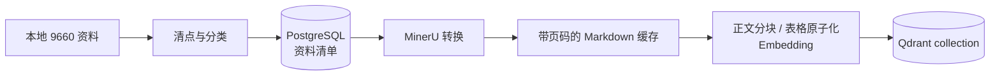
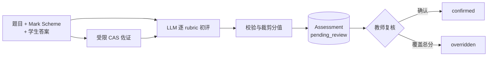
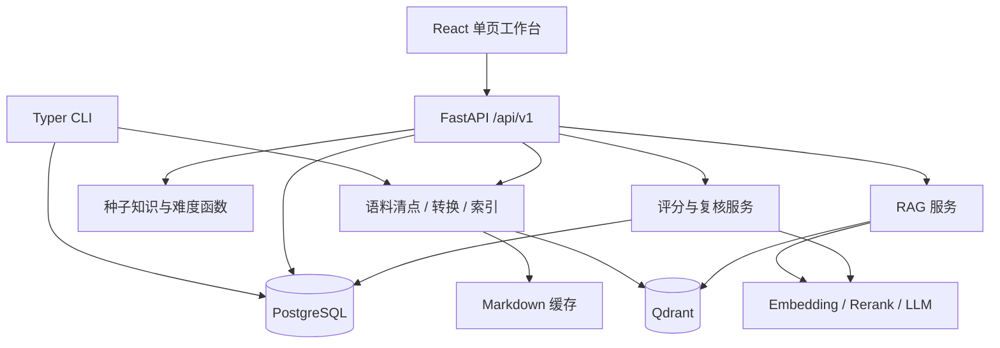

# Project Spec：ExamTwin 9660 当前真相

## 这个项目是什么

ExamTwin 9660 是面向 OxfordAQA International AS/A-level Mathematics（9660）的证据型
知识与评分工作台。它把本地课程资料整理为可追溯的语料清单和知识结构，在此基础上提供
带来源的 RAG 问答，以及必须经过教师复核的 mark scheme 自动初评。

当前产品的核心不是“自动替代教师”，也不是完整的学生数字孪生。它先守住三个基础事实：
课程大纲界定知识边界，历年 Question Paper 与 Mark Scheme 只能按年份、考季和 Unit 严格
配对，模型生成的回答与建议分必须能回到证据。

## 当前状态与重点

当前代码已经形成一条可运行的垂直切片：

- 资料可以被清点、分类并写入 PostgreSQL 清单；
- 资料可以经 MinerU 转成带页码与来源元数据的 Markdown；普通正文按语义分块，MinerU
  输出的完整表格作为不可拆分的原子证据节点，再整体重建 Qdrant 向量索引；
- 服务启动时会建立 9660 的种子知识结构和冷启动难度；
- 用户可以通过 React 工作台查看资料与知识难度、发起证据问答、提交 Markdown 答案初评；
- 每次初评都以 `pending_review` 入库，教师确认或改分后才形成已复核状态。

代码能力与数据成熟度必须分开理解。本地语料目录当前有 456 份受支持文件；按现有文件名
解析器可识别出 52 个同时具有 Question Paper 和 Mark Scheme 的严格配对键。PostgreSQL
当前记录 209 份资料已索引、247 份仍为 discovered；Qdrant 当前为 green，共 9,511 个点，
不能把“已清点 456 份”表述为“456 份均已转换入库”。

当前知识结构包含 227 个知识节点和 443 条从属、先修或大纲顺序关系；问题难度证据仍为
0 行。知识点难度目前是 D 级冷启动值；数据库虽然为难度证据预留了表，但当前代码尚未
实现从 Examiner Report 自动抽取 facility、mean mark、discrimination 或定性表现并回写
难度。

## 能力地图

| 使用场景 / 能力区 | 当前能完成什么 | 当前责任边界 |
|---|---|---|
| 语料清点 | 扫描 9660 本地资料，识别来源类型、权威等级、校验和、页数及考试身份 | 严格配对只在年份、考季、Unit 都能解析时成立；清点是增量 upsert，不会删除数据库中已消失的文件 |
| 文档转换与索引 | 用 MinerU 保留 OCR、公式、表格和页码；正文语义分块，单个完整表格原子化写入 Qdrant | 超长表只对 embedding/rerank 使用有界的全行检索投影，原表正文、跨行/跨列结构和完整原文入口不截断；超过 200 页的 PDF 分段缓存并可续跑；索引当前仍会删除旧 collection 后整体重建 |
| 知识与难度 | 展示官方 Unit/章节从属结构、推断先修关系、`[0,1]` 难度和置信度 | 章节难度目前主要是课程结构冷启动，不代表真实学生表现或官方统计 |
| 证据问答 | 向量召回、条件过滤、rerank 后，让模型仅依据检索片段回答并返回引用 | 需要已建 Qdrant collection 和云端 embedding、rerank、LLM；问答结果不持久化 |
| 自动初评 | 依据 Mark Scheme 拆分 M/A/B rubric 原子，给出建议分、学生答案证据和理由 | 缺少 Mark Scheme 时拒绝评分；CAS 只作受限符号等价佐证，不能替代方法分 |
| 人工复核 | 保存待复核 assessment；API 支持教师确认或覆盖建议总分 | 前端当前只提供“确认评分”，尚未提供改分输入；没有发布成绩或通知学生的链路 |
| 运维入口 | CLI 支持初始化、清点、统计、转换、建索引和小批量 bootstrap；REST API 暴露同类能力 | PostgreSQL、Qdrant 和外部模型服务是运行依赖，不由应用进程自身托管 |

## 使用路径

### 建立证据基础

维护者先启动 PostgreSQL 与 Qdrant，初始化数据库和种子知识结构，再清点本地 9660 语料。
清点后的每份资料获得稳定文档 ID、来源类型、权威等级和可解析的考试身份。随后选择资料
调用 MinerU 转换；转换结果以 Markdown 缓存，最后通过 embedding 重建 Qdrant collection。



`bootstrap` 只是首次验通入口：它会初始化、清点、转换有限数量的 syllabus / Question Paper /
Mark Scheme，然后仍以当前全部已转换 Markdown 为输入重建向量索引。它不是全量入库完成的
标志。

### 用证据回答问题

用户提交问题，可选限定 Unit。服务先从 Qdrant 召回候选片段，再按 Unit 和来源类型过滤，
调用 reranker 排序，最后把片段交给 LLM。响应同时返回答案、引用片段、模型给出的置信度、
grounded 标记和警告；没有匹配片段时直接返回证据不足，不调用回答模型。

当前的 `grounded` 和回答置信度来自模型响应及检索结果组织，不是独立事实核验器的判断。
引用可以追溯来源文件、页码、来源类型、严格配对键和 rerank 分数，但系统当前不保存问答
历史、用户身份或反馈。

### 从学生答案到教师复核

评分入口接收学生 Markdown 答案，以及直接提供的题目和 Mark Scheme Markdown，或一个可在
资料清单中解析到严格配对资料的引用。Mark Scheme 是唯一评分权威；缺少它时服务拒绝给分。



每个 rubric 原子保存满分、建议分、答案证据、理由、置信度和来源引用。服务端会把单项分
限制在合法范围内，并把总分限制在题目满分内。所有自动结果都强制进入复核队列；没有绕过
人工复核直接形成最终成绩的接口。

## 当前界面与交互

角色与入口：当前 Web 工作台主要服务维护语料和知识基础的开发者/内容维护者，以及执行
初评复核的教师。它是单页应用，没有登录、角色切换或学生端入口。

图示状态：当前。

```text
┌─ ExamTwin 9660 Evidence Lab ──────────────────────────────────────────────┐
│ 侧栏导航                         │ 顶栏：当前页             API 状态       │
│ ┌─────────────────────────────┐ │                                         │
│ │ 数据总览                    │ │ 当前页面内容                            │
│ │ 知识难度                    │ │ ┌─ 输入 / 操作 ─┐ ┌─ 结果 / 证据 ─┐   │
│ │ 证据问答                    │ │ │                │ │                │   │
│ │ 自动评分                    │ │ └────────────────┘ └────────────────┘   │
│ │ 人工复核            [数量]  │ │                                         │
│ └─────────────────────────────┘ │                                         │
│ 基础设施：PostgreSQL / Qdrant   │                                         │
└─────────────────────────────────┴─────────────────────────────────────────┘
```

稳定的当前关系：

- 数据总览显示资料、严格配对、知识节点和待复核数，并提供“重新清点资料”动作；
- 知识难度页按 Unit 过滤章节表，展示难度、置信度和证据等级；
- 证据问答页左侧输入问题和可选 Unit，右侧显示 Markdown 回答及可展开引用；
- 自动评分页左侧输入题目、Mark Scheme、学生答案和满分，右侧展示逐 rubric 结果；
- 人工复核页列出待复核项并允许确认，待复核数量同时出现在侧栏。

当前 UI 中的 PostgreSQL/Qdrant 指示灯实际由三项普通 API 请求是否整体成功来驱动，不是对
两个基础设施分别执行的健康检查。界面文案提到“确认或改分”，但改分目前只有服务端 API，
前端没有对应控件。

## 架构落点



- Web 入口负责五个工作页面和 API 状态反馈，不保存跨刷新会话状态。
- FastAPI 负责输入校验、错误到 HTTP 状态的映射和服务组合；应用启动时初始化数据库 schema
  并幂等写入种子知识结构。
- PostgreSQL 保存资料清单、知识节点与关系、难度证据表、assessment 和 review。
- Qdrant 只保存从已转换 Markdown 构建的向量节点；关系数据和审核状态不写入 Qdrant。
- 外部供应商负责 MinerU 文档解析、Embedding、Rerank 和 LLM；项目没有离线模型回退。

## 统一语言

- **资料（source document）**：语料目录中被清点的一份受支持文件，不等同于已经转换或索引。
- **严格配对（strict pair）**：Question Paper 与 Mark Scheme 具有相同的
  `9660:{year}:{session}:{unit}` 配对键；文件数量不等同于配对键数量。
- **权威等级（authority tier）**：`official`、`licensed_core` 或 `supplementary`，描述来源
  地位，不等同于难度证据等级。
- **证据等级（A/B/C/D）**：A 为官方量化，B 为官方定性，C 为经验证历史估计，D 为课程结构
  或模型冷启动推断。
- **知识点**：当前包括官方 Unit 和章节节点；先修边由课程顺序推断，并带置信度和来源。
- **Assessment**：一次自动初评及其逐 rubric 结果；创建时必为 `pending_review`。
- **Review**：教师对 Assessment 的确认或覆盖总分操作。
- **Grounded**：回答声称由当前检索证据支撑；它不表示答案已经由独立规则或教师确认。

## 当前边界

当前做：

- 只围绕 OxfordAQA Mathematics 9660 的本地资料、知识结构、问答和初评；
- 保留来源类型、权威等级、考试身份、页码、配对键和引用片段；
- 把模型限制在“有证据的回答”和“待人工复核的建议分”角色内；
- 通过 CLI 和单页工作台提供维护与使用入口。

当前不做：

- 学生账号、教师账号、权限隔离、多租户或审计身份认证；
- 学生长期作答记录、能力画像、认知轨迹、个性化学习状态或“考试认知仿真”；
- 自动组卷、题目生成、考试会话编排或正式成绩发布；
- 自动从 Examiner Report 抽取并融合 A/B 级难度证据；
- 问答历史、人工反馈闭环或基于真实学生表现校准难度；
- 前端改分、资料转换/索引管理、文档清单浏览或单独的基础设施健康诊断。

因此，“ExamTwin”当前是产品名称和证据基础方向，不应被解读为已经实现学生 Twin、仿真
状态机或学习轨迹更新。

## 关键考量

1. **配对键先于语义相似。** Question Paper 与 Mark Scheme 是否属于同一次考试由年份、
   考季和 Unit 决定，不能让向量相似度猜配对。
2. **权威来源与推断分层。** 官方结构可以作为 A 级来源事实；章节冷启动难度仍是 D 级，
   不能因为来自官方 syllabus 就把推断分数升级为官方量化证据。
3. **模型不拥有最终评分权。** LLM 只生成可审计的 rubric 建议；受限 CAS 只能佐证符号等价；
   教师复核是状态迁移的必经步骤。
4. **缓存服务于可恢复转换。** 大 PDF 按 200 页分段缓存，最终 Markdown 用临时文件替换，
   避免单次失败破坏已完成结果。
5. **当前索引选择一致性而非增量成本。** 每次索引都会重建整个 collection，行为简单明确，
   但资料量增长后会放大时间、外部调用成本和重建期间可用性风险。

## 长期有效的质量约束

- **功能正确性**：没有 Mark Scheme 不给分；严格配对不完整时不把 Question Paper 和
  Mark Scheme 当作同一评分依据。
- **信息安全性**：真实供应商凭据只从未跟踪的环境配置读取，不进入示例文件、响应或日志；
  所有外部调用前必须显式配置相应凭据。
- **可靠性 / 可恢复性**：MinerU 调用最多重试三次；大文档分段结果可复用；最终缓存文件采用
  临时文件替换，失败状态和错误写回资料清单。
- **可核查性**：问答返回来源引用；评分保存逐 rubric 证据、置信度和复核记录，自动建议分
  不直接发布。
- **可测试性**：普通测试不得调用真实模型服务；云端连通性与数据库集成应以显式 smoke /
  integration 验证区分。

## 阅读路径

- 第一次理解产品：先读“这个项目是什么”“能力地图”和三条“使用路径”。
- 准备语料或排查配对：读“建立证据基础”“统一语言”，再进入语料清点与转换实现。
- 修改问答：先读“用证据回答问题”，重点守住证据不足时拒答和引用可追溯边界。
- 修改评分：先读“从学生答案到教师复核”，重点守住 Mark Scheme 权威和强制人工复核。
- 修改前端：先读“当前界面与交互”，不要把尚未存在的改分、身份或学生端能力当作当前需求。

## 证据索引

| 需要核对什么 | 当前证据 |
|---|---|
| 项目定位、启动和公开契约 | [`README.md`](../../README.md)、[`pyproject.toml`](../../pyproject.toml)、[`compose.yaml`](../../compose.yaml) |
| REST 接口与输入/输出 | [`backend/src/examtwin/api/router.py`](../../backend/src/examtwin/api/router.py)、[`backend/src/examtwin/schemas.py`](../../backend/src/examtwin/schemas.py) |
| 数据表与持久化边界 | [`backend/src/examtwin/database.py`](../../backend/src/examtwin/database.py) |
| 清点、分类和严格配对 | [`backend/src/examtwin/services/inventory.py`](../../backend/src/examtwin/services/inventory.py) |
| MinerU 转换、缓存和 Qdrant 重建 | [`backend/src/examtwin/services/ingestion.py`](../../backend/src/examtwin/services/ingestion.py) |
| 知识种子和难度 | [`backend/src/examtwin/services/knowledge.py`](../../backend/src/examtwin/services/knowledge.py)、[`backend/src/examtwin/services/difficulty.py`](../../backend/src/examtwin/services/difficulty.py) |
| RAG 与供应商边界 | [`backend/src/examtwin/services/rag.py`](../../backend/src/examtwin/services/rag.py)、[`backend/src/examtwin/services/providers.py`](../../backend/src/examtwin/services/providers.py) |
| 评分、CAS 与复核状态 | [`backend/src/examtwin/services/grading.py`](../../backend/src/examtwin/services/grading.py) |
| 当前 Web 界面 | [`frontend/src/App.tsx`](../../frontend/src/App.tsx)、[`frontend/src/lib/api.ts`](../../frontend/src/lib/api.ts) |
| 自动化证据 | [`backend/tests`](../../backend/tests)、[`frontend/package.json`](../../frontend/package.json) |

本次本地核验：7 个非集成后端测试通过，后端 Ruff 检查通过，TypeScript 编译和 Vite 生产
构建通过。2 个依赖 PostgreSQL 的 integration 测试未执行；FastAPI、PostgreSQL 和 Qdrant
的实时状态以及外部模型连通性未得到验证。仓库根目录的全量 Ruff 会扫描随项目接入的
`.agents/skills/cs/`，当前在该外部技能脚本中报告 5 个格式问题；应用后端本身无 Ruff 问题。
