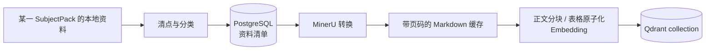
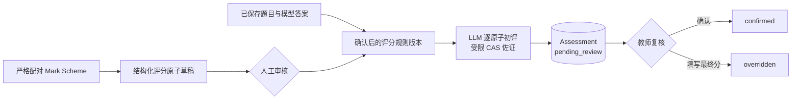
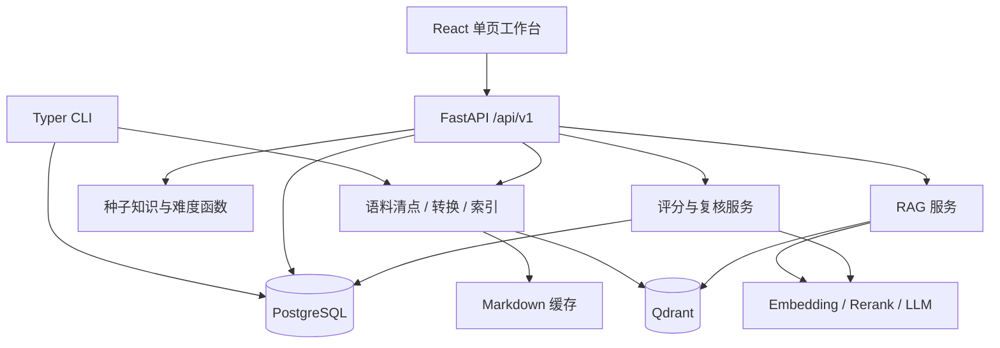

# Project Spec：ExamTwin 多科目工作台当前真相

## 这个项目是什么

ExamTwin 是面向 OxfordAQA International AS/A-level 的多科目证据型知识、整卷作答与
评分工作台。当前注册 Mathematics（9660）和 Economics（9640）两个版本化 SubjectPack；
本地课程资料被整理为可追溯语料、知识结构和检索索引，模型答案与 mark scheme 建议分都
必须回到证据，自动评分必须经过教师复核。

当前产品的核心不是“自动替代教师”，也不是完整的学生数字孪生。它先守住三个基础事实：
课程大纲界定知识边界，历年 Question Paper 与 Mark Scheme 只能按年份、考季和 Unit 严格
配对，模型生成的回答与建议分必须能回到证据。

## 当前状态与重点

当前代码已经形成可运行的多科目垂直切片：

- 资料进入按科目隔离的工作区；上传原件先写入托管对象存储，再保存来源角色、授权状态、考试
  身份、对象键和校验和，后续转换按需物化原件，不以宿主机上传目录作为事实源；
- 核心知识库只允许 syllabus / textbook，补充知识库只允许授权的教学资料；版本构建完成后以
  staging collection + live alias 原子发布，API 启动不隐式重建；
- 已发布知识库可生成带逐节点、逐关系来源证据的图谱草稿，人工审核后发布为检索上下文；
- 整卷 Worker 只使用已发布知识库、已发布图谱、原题和按题匹配的 Insert 作答，运行账本保存
  实际知识库与图谱版本；Mark Scheme 和 Examiner Report 不进入作答检索；
- 教师从已完成作答选择严格配对 Mark Scheme，逐条审核版本化评分原子；只有全部原子有人工
  审核记录且至少一条被接受时才能确认版本，逐题初评后仍必须确认或改分。

代码能力与数据成熟度必须分开理解。2026-08-06 本地运行快照中，9660 清点 456 份资料、
64 个严格配对键；版本化 Core Knowledge Base v1 由 1 份 syllabus 和 3 份授权教材构成，
已发布 4,975 个向量点。原有 22,011 点混合索引 alias 保留为历史兼容入口，但不伪装成
Core 版本。9640 清点 273 份资料、40 个严格配对键，受控核心知识库 v3 由 2 份 syllabus
和 2 份授权教材构成并发布 5,101 个向量点。
两科考试身份不完整数均为 0；仍有 9660 的 5 份和 9640 的 4 份 Question Paper 没有严格
配对 Mark Scheme，不能用于自动评分。

SubjectPack 课程结构仍包含 9660 的 227 个知识节点 / 371 条关系，以及 9640 的 573 个知识
节点 / 972 条关系。9640 另有从核心知识库 v3 生成并发布的证据图谱 v2：201 个已接受节点、
253 条关系；一次真实新作答运行已记录该图谱和核心知识库版本。两科
`question_difficulty_rows` 均为 0；当前正式知识点难度主要是旧 P3 的 D 级课纲 AI 冷启动历史值。
新发布路径已改为模型结合 syllabus / 授权 textbook 原文、在 Unit 内直接给分并保留逐字引用；
9640 已通过 568 个目标材料覆盖和 3 个真实模型样本冒烟，但尚未执行全量付费发布。两者都不得
表述为 Examiner Report 或真实学生表现校准结果。

## 能力地图

| 使用场景 / 能力区 | 当前能完成什么 | 当前责任边界 |
|---|---|---|
| 语料清点 | 按 SubjectPack 扫描本地资料，识别来源类型、权威等级、校验和、页数及考试身份 | 严格配对只在年份、考季、Unit 都能解析时成立；样卷、章节练习和显式属于其他资格代码的试卷不进入当前科目严格配对 |
| 文档转换与知识版本 | 用 MinerU 保留 OCR、公式、表格和页码；按来源策略生成层级文档块；核心/补充知识库独立构建并通过 Qdrant live alias 原子发布 | 核心库只接受 syllabus / textbook；补充库只接受获授权教学资料；评估资料不进入 RAG；失败保留上一 live 版本 |
| 知识图谱与难度 | 从课纲生成课程结构；为 Topic / Learning Objective 从已发布核心库匹配课纲和授权教材原文，按 Unit 批量让模型直接评级并经引用门禁后事务发布；另可从知识版本生成证据化节点/关系草稿并审核发布 | 图谱发布前不参与检索；D 级模型评级不是题目难度或官方表现统计；缺资料、模型失败或引用不实即保留上一版，A/B/C 级证据流水线仍未完成 |
| 整卷证据作答 | 上传 PDF 或 Markdown，持久 Worker 分类、视觉复核、分批拆题并用受控 Agent 逐题作答；运行账本冻结知识库/图谱版本和可重放工具结果 | 只有高置信 Question Paper 继续；Mark Scheme / Examiner Report 不可检索；Insert 仅按同场次、当前题需要读取；部分失败可单题重试 |
| 自动初评 | 从已完成作答选择严格配对 Mark Scheme，逐条接受、拒绝或修改类型化评分原子；全部原子经审核且至少一条接受后确认版本，再逐题生成建议分、答案证据、错误类型和改进建议 | 后端按科目隔离评分规则，并在创建时强制 Question Paper / Mark Scheme 的年份、考季、Unit 完全一致；只按当前题已接受原子评分，缺少已确认版本时拒绝 |
| 人工复核 | 评分原子每次审核保存审核人、时间、状态、备注和修改前后值；assessment 另进入待复核队列，教师可确认建议分或填写最终分改分 | 不提供“一键全部接受”；自动建议分不直接发布；当前没有学生账号和正式成绩发布链路 |
| 运维入口 | CLI/API 支持数据库升级、清点、转换、知识版本、图谱、检索评测与持久 Worker；Web 提供科目、资料、知识、作答、评分和复核工作区 | PostgreSQL、Qdrant、对象存储和外部模型服务是运行依赖；API/基础设施仅绑定 loopback |

## 使用路径

### 建立证据基础

维护者启动 PostgreSQL、Qdrant 与对象存储，选择或创建科目后清点语料。每份资料获得稳定文档
ID、来源类型、来源角色、授权状态、权威等级和考试身份；转换后的 Markdown 按策略生成层级
文档块。维护者把合格来源加入核心或补充知识库，显式构建不可变版本并通过科目独立 live alias
发布；随后可从该版本生成知识图谱草稿，经证据核对和人工审核后发布。

`bootstrap` 只是首次验通入口：它会初始化、清点、转换有限数量的 syllabus / Question Paper /
Mark Scheme，然后仍以当前全部已转换 Markdown 为输入重建向量索引。它不是全量入库完成的
标志。

### 用证据回答问题

用户提交问题，可选限定 Unit。服务从当前科目的已发布知识版本召回，先以 Qdrant payload
预过滤科目、版本、Unit 与允许来源，再融合 dense / lexical 候选、rerank，并可用已发布图谱
扩展查询。响应返回答案、引用、模型置信度、grounded 标记和警告；没有证据时直接拒答。

整卷作答额外冻结每题实际使用的知识库版本、图谱版本、来源页、Agent 步骤和工具结果。
Question Paper / Mark Scheme / Examiner Report 不属于普通 RAG 证据；Insert 只在严格配对且
当前题确实依赖资料册时读取。`grounded` 仍是检索与模型契约的结果，不是独立事实核验器。

### 从已完成作答到教师复核

教师在评分工作区选择已完成或部分完成的整卷作答，再选择同科目、同年份、同考季、同 Unit
且身份完整的官方 Mark Scheme。系统把评分方案解析为版本化、可审核的 point-based /
levels-based 原子，保留题号、子问、分值类型、依赖、替代路径、精度、单位、FT 规则和来源
摘录；题号显示格式会规范映射回持久化试卷题号。教师须逐条接受、拒绝或修改，系统保存每次
审核的前后值。只有所有原子都有审核记录且至少一条被接受，评分规则版本才能确认并用于评分。

每次初评只读取当前试题的已接受评分原子，并保存逐原子建议分、学生答案证据、理由、置信度、
错误类型、改进建议和所用知识库/图谱版本；服务把单项和总分限制在合法范围。评分原子审核和
assessment 的人工确认或改分分别写入追加式审计记录，没有批量接受评分原子或绕过复核直接
形成最终成绩的接口。

## 当前界面与交互

当前 Web 工作台是按科目切换的单页应用，服务资料与知识维护者、作答验收人员和执行初评复核
的教师；没有登录、角色切换、学生端或成绩发布入口。

稳定的当前入口：

- **状态总览**：显示 PostgreSQL、Qdrant、对象存储组件健康，科目资料、严格配对、知识版本、
  向量点和待复核数量，并可创建科目或重新清点；
- **试卷作答**：上传整卷，显示持久任务阶段、逐题进度、Agent 工具步骤、答案、图表、来源页和
  可展开引用，失败题可单独重试；
- **知识库**：资料工作区负责分类、授权和上传；核心/补充知识库负责版本输入与发布；图谱生产
  页生成、可视化编辑、审核并发布节点关系；层级浏览显示课程结构；
- **答案评分**：选择既有作答和严格配对的官方 Mark Scheme，逐条筛选、编辑、接受或拒绝评分
  原子；满足确认门禁后逐题生成可审计评分报告；
- **复核队列**：填写复核人，可确认建议分或输入最终分改分，侧栏同步显示待复核数量。

主题支持浅色、跟随系统和深色。所有科目相关请求携带显式科目上下文；未选择科目或科目未
绑定能力模板时，对应入口保持受限状态。

## 架构落点

- Web 入口负责五个工作页面和 API 状态反馈，不保存跨刷新会话状态。
- FastAPI 负责输入校验、错误到 HTTP 状态的映射和服务组合；应用启动时初始化数据库 schema
  并幂等写入种子知识结构。
- PostgreSQL 保存资料清单、知识节点与关系、难度证据表、assessment 和 review。
- Qdrant 只保存从已转换 Markdown 构建的向量节点；关系数据和审核状态不写入 Qdrant。
- 外部供应商负责 MinerU 文档解析、Embedding、Rerank 和 LLM；项目没有离线模型回退。

## 统一语言

- **资料（source document）**：某科目语料目录中被清点的一份受支持文件，不等同于已经转换或索引。
- **严格配对（strict pair）**：同一科目的 Question Paper 与 Mark Scheme 具有相同
  `{subject_code}:{year}:{session}:{unit}` 配对键；文件数量不等同于配对键数量。
- **SubjectPack**：版本化学科运行契约，声明科目代码、Unit、语料根、Qdrant alias、课纲解析和答题能力；请求必须显式选择科目。
- **权威等级（authority tier）**：`official`、`licensed_core` 或 `supplementary`，描述来源地位，不等同于难度证据等级。
- **证据等级（A/B/C/D）**：A 为官方量化，B 为官方定性，C 为经验证历史估计，D 为课程结构或模型冷启动推断。
- **知识点**：当前包括 Unit、章节和学习目标；关系、定义与难度均须保留科目、来源和版本。
- **Assessment**：一次自动初评及其逐 rubric 结果；创建时必为 `pending_review`。
- **Review**：教师对 Assessment 的确认或覆盖总分操作。
- **Grounded**：回答声称由当前检索证据支撑；不表示答案已由独立规则或教师确认。

## 当前边界

当前做：

- 围绕已注册的 9660 与 9640 SubjectPack 提供资料、知识、整卷证据作答和初评；
- 保留来源类型、权威等级、考试身份、页码、配对键、引用、任务检查点和 Agent run；
- 把模型限制在“有证据的回答”和“待人工复核的建议分”角色内；
- 通过 CLI、REST/WebSocket 和单页工作台提供维护与使用入口。

当前不做：

- 学生账号、教师账号、权限隔离、多租户或对外互联网部署；
- 学生长期作答记录、能力画像、认知轨迹或个性化学习状态；
- 自动组卷、题目生成、考试会话编排或正式成绩发布；
- 无来源地批量生成题目难度，或把 D 级冷启动值表述为官方统计；
- 未经 SubjectPack 注册的科目、动态可执行插件或任意外部工具；
- 基于真实学生表现的自动校准和正式发布闭环。

因此，“ExamTwin”当前是产品名称和证据基础方向，不应被解读为已经实现学生 Twin、仿真
状态机或学习轨迹更新。

## 关键考量

1. **配对键先于语义相似。** Question Paper 与 Mark Scheme 是否属于同一次考试由年份、
   考季和 Unit 决定，不能让向量相似度猜配对。
2. **权威来源与推断分层。** 官方结构可以作为 A 级来源事实；章节冷启动难度仍是 D 级，
   不能因为来自官方 syllabus 就把推断分数升级为官方量化证据。
3. **模型不拥有最终评分权。** LLM 只生成可审计的 rubric 建议；受限 CAS 只能佐证符号等价；
   教师复核是状态迁移的必经步骤。
4. **缓存服务于可恢复转换。** 大 PDF 分段结果与对象存储产物按输入和配置身份复用，最终写入采用原子替换，失败不破坏已完成结果。
5. **发布先构建、后切换。** PostgreSQL 图谱以事务发布；Qdrant 先写 staging collection，
   质量门禁通过后才切换科目 live alias，失败保持上一版本可用。

## 长期有效的质量约束

- **功能正确性**：没有 Mark Scheme 不给分；严格配对不完整时不把 Question Paper 和
  Mark Scheme 当作同一评分依据。
- **信息安全性**：真实供应商凭据只从未跟踪的环境配置读取，不进入示例文件、响应或日志；
  所有外部调用前必须显式配置相应凭据。
- **可靠性 / 可恢复性**：MinerU 调用最多重试三次；大文档分段结果可复用；最终缓存文件采用
  临时文件替换，失败状态和错误写回资料清单。
- **可核查性**：问答返回来源引用；评分保存逐 rubric 证据、置信度和复核记录，自动建议分
  不直接发布。
- **可测试性**：普通测试不得调用真实模型服务；云端连通性与数据库集成应以显式 smoke /
  integration 验证区分。

## 阅读路径

- 第一次理解产品：先读“这个项目是什么”“能力地图”和三条“使用路径”。
- 准备语料或排查配对：读“建立证据基础”“统一语言”，再进入语料清点与转换实现。
- 修改问答：先读“用证据回答问题”，重点守住证据不足时拒答和引用可追溯边界。
- 修改评分：先读“从学生答案到教师复核”，重点守住 Mark Scheme 权威和强制人工复核。
- 修改前端：先读“当前界面与交互”，不要把尚未存在的改分、身份或学生端能力当作当前需求。

## 证据索引

| 需要核对什么 | 当前证据 |
|---|---|
| 项目定位、启动和公开契约 | [`README.md`](../../README.md)、[`pyproject.toml`](../../pyproject.toml)、[`compose.yaml`](../../compose.yaml) |
| REST 接口与输入/输出 | [`backend/src/examtwin/app/api/router.py`](../../backend/src/examtwin/app/api/router.py)、[`backend/src/examtwin/contracts/`](../../backend/src/examtwin/contracts/) |
| 数据表与持久化边界 | [`backend/src/examtwin/platform/database/`](../../backend/src/examtwin/platform/database/)、[`backend/migrations/`](../../backend/migrations/) |
| 清点、分类和严格配对 | [`backend/src/examtwin/knowledge/inventory.py`](../../backend/src/examtwin/knowledge/inventory.py)、[`subject-packs/`](../../subject-packs/) |
| MinerU 转换与 Qdrant 发布 | [`backend/src/examtwin/knowledge/ingestion.py`](../../backend/src/examtwin/knowledge/ingestion.py)、[`backend/src/examtwin/knowledge/vector_retrieval.py`](../../backend/src/examtwin/knowledge/vector_retrieval.py) |
| 知识构建和难度 | [`backend/src/examtwin/knowledge/pipeline.py`](../../backend/src/examtwin/knowledge/pipeline.py)、[`backend/src/examtwin/knowledge/difficulty.py`](../../backend/src/examtwin/knowledge/difficulty.py) |
| RAG、Agent 与供应商边界 | [`backend/src/examtwin/assessment/rag.py`](../../backend/src/examtwin/assessment/rag.py)、[`backend/src/examtwin/assessment/answering_agent/`](../../backend/src/examtwin/assessment/answering_agent/)、[`backend/src/examtwin/platform/providers.py`](../../backend/src/examtwin/platform/providers.py) |
| 整卷任务、评分与复核 | [`backend/src/examtwin/assessment/paper_jobs.py`](../../backend/src/examtwin/assessment/paper_jobs.py)、[`backend/src/examtwin/assessment/paper_worker.py`](../../backend/src/examtwin/assessment/paper_worker.py)、[`backend/src/examtwin/assessment/grading.py`](../../backend/src/examtwin/assessment/grading.py) |
| 当前 Web 界面 | [`frontend/src/App.tsx`](../../frontend/src/App.tsx)、[`frontend/src/lib/api.ts`](../../frontend/src/lib/api.ts) |
| 自动化证据 | [`backend/tests`](../../backend/tests)、[`frontend/package.json`](../../frontend/package.json) |

2026-08-05 本地核验：后端 Ruff check/format、basedpyright、OpenAPI 快照和 uv lock 均通过；
Python 3.11、3.12、3.13 各有 210 个非集成测试通过，PostgreSQL/Qdrant/S3 集成测试
17 个通过。前端 OpenAPI 类型、18 个 Vitest、ESLint 和 TypeScript/Vite 生产构建通过。
真实供应商冒烟验证 `gpt-5.6-sol` 结构化答案、Qwen3 Embedding（4096 维）和 Reranker；
9660/9640 live alias 检索黄金集分别达到 Recall@5 1.0、MRR 0.8958 / 0.8438，均无空结果或
范围越界。最终镜像已重建，API 契约 `2026-08-05.hybrid-retrieval-v24`、PostgreSQL、
Qdrant、对象存储和两科索引均在线。
