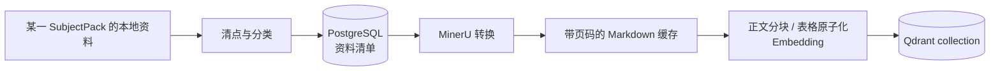
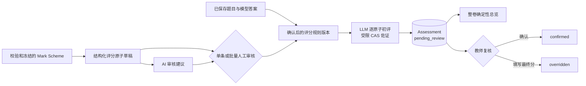
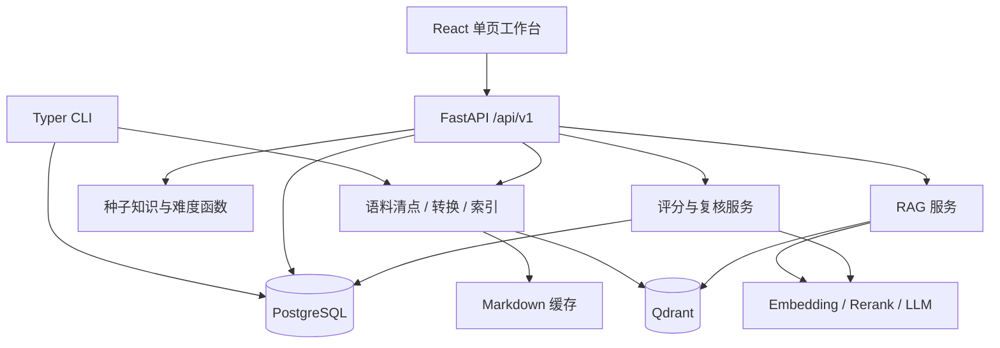

# Project Spec：ExamTwin 多科目工作台当前真相

## 这个项目是什么

ExamTwin 是面向 OxfordAQA International AS/A-level 的多科目证据型知识、整卷作答与
评分工作台。当前注册 Mathematics（9660）和 Economics（9640）两个版本化 SubjectPack；
本地课程资料被整理为可追溯语料、知识结构和检索索引，模型答案与 mark scheme 建议分都
必须回到证据，自动评分必须经过教师复核。

当前产品的核心不是“自动替代教师”，也不是完整的学生数字孪生。它先守住三个基础事实：
课程大纲界定知识边界，历年 Question Paper 与 Mark Scheme 只能按年份、考季和 Unit 严格
配对，模型生成的回答与建议分必须能回到证据。

## 当前状态与重点

当前代码已形成经过真实双科验收的本地单用户垂直切片：

- 科目、试卷和复核是 Web 的三个稳定领域入口；作答、外部答案导入和评分都在具体试卷及作答
  记录的 URL 上下文内展开，不再作为与科目、试卷平级的独立模块；
- 资料进入按科目隔离的工作区；上传原件先写入托管对象存储，再保存来源角色、授权状态、考试
  身份、对象键和校验和，后续转换不以宿主机上传目录作为事实源；
- 核心知识库只允许 syllabus / textbook，补充知识库只允许授权教学资料；版本构建完成后以
  staging collection + live alias 原子发布，失败保持上一版本在线；
- 整卷 Worker 使用已发布知识库、已发布图谱、原题和按题匹配的 Insert 作答，运行账本冻结
  知识库、图谱、资料和工具结果；Mark Scheme 和 Examiner Report 不进入作答检索；
- 教师从具体作答记录进入评分，选择严格配对 Mark Scheme，审核版本化评分原子，再逐题生成
  建议分和整卷报告；模型结果始终等待人工确认或改分。

2026-08-17 运行态中，数学 9660 Core Knowledge Base v5 由 4 份来源原子发布 4,999 点；
经济 9640 Core v4 发布 5,051 点。最终检索黄金集分别为数学 14/14、经济 9/9，
Recall@5 均为 `1.0`，MRR 为 `0.8595` / `0.8889`，两科空结果率和范围污染均为 0。
数学当前有 448 份资料、64 个严格配对键、227 个知识节点；经济有 273 份资料、40 个严格
配对键、573 个知识节点。两科考试身份不完整数均为 0；仍有数学 5 份、经济 4 份
Question Paper 没有严格配对 Mark Scheme，只能用于检索或作答，不能自动评分。

数学和经济的系统 AI 作答与上传答案四条路径均已由真实浏览器走到整卷报告，并验证错科读取
返回 404。两科 `question_difficulty_rows` 仍为 0；正式知识点难度主要是 D 级课纲模型冷启动
历史值。Examiner Report 的 A/B 级观测抽取、题号映射和聚合发布仍未完成，不得把当前结果
表述为真实学生表现校准或完整数字孪生。

## 能力地图

| 使用场景 / 能力区 | 当前能完成什么 | 当前责任边界 |
|---|---|---|
| 语料清点 | 按 SubjectPack 扫描本地资料，识别来源类型、权威等级、校验和、页数及考试身份 | 严格配对只在年份、考季、Unit 都能解析时成立；样卷、章节练习和显式属于其他资格代码的试卷不进入当前科目严格配对 |
| 文档转换与知识版本 | 用 MinerU 保留 OCR、公式、表格和页码；按来源策略生成层级文档块；核心/补充知识库独立构建并通过 Qdrant live alias 原子发布 | 核心库只接受 syllabus / textbook；补充库只接受获授权教学资料；评估资料不进入 RAG；失败保留上一 live 版本 |
| 知识图谱与难度 | 从课纲生成课程结构；为 Topic / Learning Objective 从已发布核心库匹配课纲和授权教材原文，按 Unit 批量让模型直接评级并经引用门禁后事务发布；另可从知识版本生成证据化节点/关系草稿并审核发布 | 图谱发布前不参与检索；D 级模型评级不是题目难度或官方表现统计；缺资料、模型失败或引用不实即保留上一版，A/B/C 级证据流水线仍未完成 |
| 整卷证据作答 | 上传 PDF 或 Markdown，持久 Worker 分类、视觉复核、分批拆题并用受控 Agent 逐题作答；MinerU 题内图片按物理页归档并保留在题干原位置；运行账本冻结知识库/图谱版本和可重放工具结果 | 只有高置信 Question Paper 继续；Mark Scheme / Examiner Report 不可检索；Insert 仅按同场次、当前题需要读取；部分失败可单题重试 |
| 自动初评 | 从已完成作答选择严格配对 Mark Scheme，审核类型化评分原子；支持当前筛选下至多 200 条原子的原子批量人工决策，以及独立保存、须教师确认后才能应用的 AI 接受 / 拒绝 / 修改建议；规则确认后逐题生成建议分并汇总整卷完成度、得分、共性问题和逐题建议 | Mark Scheme 转换产物按来源校验和不可变保存，规则冻结来源文档与校验和；批量人工审核全有或全无且逐条追加审计；AI 建议不改变人工状态；总览只取指定规则下每题最新持久 assessment |
| 人工复核 | 评分原子单条或批量审核均保存审核人、时间、状态、备注和修改前后值；AI 建议另行追加保存；assessment 另进入待复核队列，教师可确认建议分或填写最终分改分 | 批量拒绝和应用 AI 建议须明确确认；自动建议分与 AI 建议都不直接发布；当前没有学生账号和正式成绩发布链路 |
| 运维入口 | CLI/API 支持数据库升级、清点、转换、知识版本、检索评测与持久 Worker；Web 提供科目、试卷和复核工作区 | PostgreSQL、Qdrant、对象存储和外部模型服务是运行依赖；API 默认绑定 loopback。若关闭本地访问中间件并绑定非 loopback，健康状态必须降级并明确当前没有认证边界 |

## 使用路径

### 建立证据基础

维护者启动 PostgreSQL、Qdrant 与对象存储，选择或创建科目后清点语料。每份资料获得稳定文档
ID、来源类型、来源角色、授权状态、权威等级和考试身份；转换后的 Markdown 按策略生成层级
文档块。维护者把合格来源加入核心或补充知识库，显式构建不可变版本并通过科目独立 live alias
发布；随后可从该版本生成知识图谱草稿，经证据核对和人工审核后发布。

`bootstrap` 只是首次验通入口：它会初始化、清点、转换有限数量的 syllabus / Question Paper /
Mark Scheme，然后仍以当前全部已转换 Markdown 为输入重建向量索引。它不是全量入库完成的
标志。

### 用证据回答问题

用户提交问题，可选限定 Unit。服务从当前科目的已发布知识版本召回，先以 Qdrant payload
预过滤科目、版本、Unit 与允许来源，再融合 dense / lexical 候选、rerank，并可用已发布图谱
扩展查询。响应返回答案、引用、模型置信度、grounded 标记和警告；没有证据时直接拒答。

整卷作答额外冻结每题实际使用的知识库版本、图谱版本、来源页、Agent 步骤和工具结果。
Question Paper / Mark Scheme / Examiner Report 不属于普通 RAG 证据；Insert 只在严格配对且
当前题确实依赖资料册时读取。`grounded` 仍是检索与模型契约的结果，不是独立事实核验器。

直接课程节点作为核心知识图谱在检索索引中的身份投影参与本地稀疏候选和确定性课程匹配，
可以在同科综合试卷中跨 Unit 识别规范知识编号，但不单独充当答案引用。最终引用仍必须落到
当前科目、来源角色和检索范围允许的 syllabus / textbook 原文；外部 reranker 超时时只退回
已经通过这些门禁的本地顺序。

整卷分题的权威主源是按物理页保存的视觉复核 Markdown。每个持久化题目必须由该主源证明：
顶层题号顺序、子问标签、逐项分值、总分和来源页完全一致；图形、坐标轴、阴影、表格等视觉
依赖在这次对账中判定一次并持久化，作答阶段只消费判定结果。重叠批次产生同题冲突时，只有
冲突路径调用一次有界结构化模型选择权威候选，随后仍由题号、子问、分值、来源页和视觉依赖
守恒门禁验收；模型不能自由改写题目，无法闭合时失败关闭。

PDF 文本层只承担恢复定位证据，不能覆盖或逐字段补写已经存在的视觉主源题目。恢复候选必须
重新与可见原卷页逐项对账；跨批候选只按题号和子问标签确定性合并，不按文本长度择优。分题
和页级视觉 checkpoint 只在契约版本与输入摘要一致时复用。MinerU 的物理页内容块先生成页级
Markdown，逐页视觉请求不重复携带整个多页分块；输入收口降低重复成本，但外部视觉模型推理
和服务波动仍是整卷任务的主要耗时。

旧版已结束任务不被原地改写，统一标为未通过当前来源完整性契约，答案页和历史列表都会明确
警告，且不能原地重试。用户可以从原任务创建使用同一原卷和 Unit 的全新替代任务；旧任务、
新任务及替代方向永久保留审计关系。

逐题结果中的知识点只接受答案以 `[S#]` 实际引用、由该引用绑定、且存在于当前科目目录的
编号；按引用首次出现顺序去重，最多保留四个。没有可靠绑定时保持空列表，不用词面重叠或
课纲顺序伪造映射。最终编号与答案在同一次题目完成事务中保存，使查询、重试和展示读取同一
份结果。

### 从已完成作答到教师复核

教师在评分工作区选择已完成或部分完成的整卷作答，再选择同科目、同年份、同考季、同 Unit
且身份完整的官方 Mark Scheme。转换产物与精确来源校验和绑定；来源变化后旧评分规则不会被新
内容静默复用。系统把评分方案解析为版本化、可审核的 point-based / levels-based 原子，保留
题号、子问、分值类型、依赖、替代路径、精度、单位、FT 规则和来源摘录。教师可单条审核，也
可对当前筛选下的原子执行原子批量接受 / 拒绝；每条决定仍独立审计，整批事务全有或全无。
AI 审核只追加接受 / 拒绝 / 需修改建议、置信度、理由和建议 patch；教师填写审核人并确认应用
后，接受 / 拒绝建议才进入人工状态，需修改项仍须单条编辑。只有所有原子都有人工审核记录且
至少一条被接受，评分规则版本才能确认并用于评分。

每次初评只读取当前试题的已接受评分原子，并保存逐原子建议分、学生答案证据、理由、置信度、
错误类型、改进建议和所用知识库/图谱版本；服务把单项和总分限制在合法范围。整卷总览按指定
评分规则选择每题最新 assessment，使用持久化最终分，明确显示缺失题目并确定性聚合共性问题、
总体建议和逐题建议，不新增第二个总分事实源。人工改分的最终分数必须位于
`[0, total_available]`，该约束由仓储事务内的领域校验强制。评分原子人工审核、AI 建议和
assessment 人工确认 / 改分分别写入追加式记录，任何模型输出都不能绕过人工门禁形成最终成绩。

## 当前界面与交互

当前 Web 是面向本机受信教师和内容维护者的多科目单页工作台；没有登录、角色切换、学生端或
成绩发布入口。稳定主导航只有三个领域入口：

- **科目**：目录展示科目名称、代码、资料、知识点和向量状态；详情以稳定 URL 提供基本信息、
  资料工作区和核心/补充知识库版本构建，不把基础设施状态或图谱内部生产流程当作主任务；
- **试卷**：先在科目上下文中按考试单元归档 Question Paper、Mark Scheme 和 Source Booklet；
  试卷详情是 AI 作答、外部答案导入、作答记录、评分和整卷报告的共同上文。科目、试卷单元、
  作答任务和评分状态由 URL 与后端事实确定，不用 `localStorage` 或独立步骤状态充当事实源；
- **复核**：合并展示全部科目的待复核项；提交决定前必须展示题目、答案、Rubric、证据、
  建议分和置信度，教师可以确认或在合法范围内改分。

前端使用 Ant Design 6 承担主题、表单、表格、上传、弹窗和反馈，React Router 拥有业务 URL，
TanStack Query 只拥有服务端缓存、请求取消和精确失效。快速切换科目时，旧请求不得覆盖当前
结果。桌面和窄屏共享同一信息结构；危险删除具有明确范围、二次确认和可恢复/永久删除边界。

## 架构落点

- Web 壳只负责“科目、试卷、复核”导航、主题和跨科目复核数量；业务上下文由 URL 与服务端事实保存。
- FastAPI 只负责协议输入输出与错误到 HTTP 状态的映射；依赖构造集中在应用组合根，不在
  handler 内拼装持久化或供应商实现。
- 资料分类、授权等级与知识库归属由 subjects 统一决策；knowledge 应用服务拥有资料注册、
  对象写入失败补偿、重复考试身份合并，以及知识库版本的转换、索引、发布和失败回写。
  应用启动时初始化数据库 schema 并幂等写入种子知识结构。
- PostgreSQL 保存资料清单、知识节点与关系、难度证据表、assessment 和 review。
- Qdrant 只保存从已转换 Markdown 构建的向量节点；关系数据和审核状态不写入 Qdrant。
- 外部供应商负责 MinerU 文档解析、Embedding、Rerank 和 LLM；项目没有离线模型回退。

## 统一语言

- **资料（source document）**：某科目语料目录中被清点的一份受支持文件，不等同于已经转换或索引。
- **严格配对（strict pair）**：同一科目的 Question Paper 与 Mark Scheme 具有相同
  `{subject_code}:{year}:{session}:{unit}` 配对键；文件数量不等同于配对键数量。
- **SubjectPack**：版本化学科运行契约，声明科目代码、Unit、语料根、Qdrant alias、课纲解析和答题能力；请求必须显式选择科目。
- **权威等级（authority tier）**：`official`、`licensed_core` 或 `supplementary`，描述来源地位，不等同于难度证据等级。
- **证据等级（A/B/C/D）**：A 为官方量化，B 为官方定性，C 为经验证历史估计，D 为课程结构或模型冷启动推断。
- **知识点**：当前包括 Unit、章节和学习目标；关系、定义与难度均须保留科目、来源和版本。
- **Assessment**：一次自动初评及其逐 rubric 结果；创建时必为 `pending_review`。
- **Review**：教师对 Assessment 的确认或覆盖总分操作。
- **Grounded**：回答声称由当前检索证据支撑；不表示答案已由独立规则或教师确认。

## 当前边界

当前做：

- 围绕已注册的 9660 与 9640 SubjectPack 提供资料、知识、整卷证据作答和初评；
- 保留来源类型、权威等级、考试身份、页码、配对键、引用、任务检查点和 Agent run；
- 把模型限制在“有证据的回答”和“待人工复核的建议分”角色内；
- 通过 CLI、REST/WebSocket 和单页工作台提供维护与使用入口。

当前不做：

- 学生账号、教师账号、权限隔离、多租户或对外互联网部署；
- 学生长期作答记录、能力画像、认知轨迹或个性化学习状态；
- 自动组卷、题目生成、考试会话编排或正式成绩发布；
- 无来源地批量生成题目难度，或把 D 级冷启动值表述为官方统计；
- 未经 SubjectPack 注册的科目、动态可执行插件或任意外部工具；
- 基于真实学生表现的自动校准和正式发布闭环。

因此，“ExamTwin”当前是产品名称和证据基础方向，不应被解读为已经实现学生 Twin、仿真
状态机或学习轨迹更新。

## 关键考量

1. **配对键先于语义相似。** Question Paper 与 Mark Scheme 是否属于同一次考试由年份、
   考季和 Unit 决定，不能让向量相似度猜配对。
2. **权威来源与推断分层。** 官方结构可以作为 A 级来源事实；章节冷启动难度仍是 D 级，
   不能因为来自官方 syllabus 就把推断分数升级为官方量化证据。
3. **模型不拥有最终评分权。** LLM 只生成可审计的 rubric 建议；受限 CAS 只能佐证符号等价；
   教师复核是状态迁移的必经步骤。
4. **缓存服务于可恢复转换。** 大 PDF 分段结果与对象存储产物按输入和配置身份复用，最终写入采用原子替换，失败不破坏已完成结果。
5. **发布先构建、后切换。** PostgreSQL 图谱以事务发布；Qdrant 先写 staging collection，
   质量门禁通过后才切换科目 live alias，失败保持上一版本可用。

## 长期有效的质量约束

- **功能正确性**：没有 Mark Scheme 不给分；严格配对不完整时不把 Question Paper 和
  Mark Scheme 当作同一评分依据。
- **信息安全性**：真实供应商凭据只从未跟踪的环境配置读取，不进入示例文件、响应或日志；
  所有外部调用前必须显式配置相应凭据。当前没有认证、授权或租户边界；关闭本地访问限制且
  绑定非 loopback 必须健康降级，不得把该配置视为可直接公开部署。
- **可靠性 / 可恢复性**：MinerU 调用最多重试三次；大文档分段结果可复用；最终缓存文件采用
  临时文件替换，失败状态和错误写回资料清单。
- **可核查性**：问答返回来源引用；评分保存逐 rubric 证据、置信度和复核记录，自动建议分
  不直接发布。
- **可测试性**：普通测试不得调用真实模型服务；云端连通性与数据库集成应以显式 smoke /
  integration 验证区分。

## 阅读路径

- 第一次理解产品：先读“这个项目是什么”“能力地图”和三条“使用路径”。
- 准备语料或排查配对：读“建立证据基础”“统一语言”，再进入语料清点与转换实现。
- 修改问答：先读“用证据回答问题”，重点守住证据不足时拒答和引用可追溯边界。
- 修改评分：先读“从已完成作答到教师复核”，重点守住 Mark Scheme 权威、评分原子人工确认和最终人工复核。
- 修改前端：先读“当前界面与交互”，不要恢复五个平级模块、全局 mutable 科目上下文或独立步骤事实源。

## 证据索引

| 需要核对什么 | 当前证据 |
|---|---|
| 项目定位、启动和公开契约 | [`README.md`](../../README.md)、[`pyproject.toml`](../../pyproject.toml)、[`compose.yaml`](../../compose.yaml) |
| REST 接口与输入/输出 | [`backend/src/examtwin/app/api/router.py`](../../backend/src/examtwin/app/api/router.py)、[`backend/src/examtwin/contracts/`](../../backend/src/examtwin/contracts/) |
| 数据表与持久化边界 | [`backend/src/examtwin/platform/database/`](../../backend/src/examtwin/platform/database/)、[`backend/migrations/`](../../backend/migrations/) |
| 资料归属、上传与知识版本构建 | [`backend/src/examtwin/subjects/document_assignment.py`](../../backend/src/examtwin/subjects/document_assignment.py)、[`backend/src/examtwin/knowledge/workspace_service.py`](../../backend/src/examtwin/knowledge/workspace_service.py) |
| 清点、分类和严格配对 | [`backend/src/examtwin/knowledge/inventory.py`](../../backend/src/examtwin/knowledge/inventory.py)、[`subject-packs/`](../../subject-packs/) |
| MinerU 转换与 Qdrant 发布 | [`backend/src/examtwin/knowledge/ingestion.py`](../../backend/src/examtwin/knowledge/ingestion.py)、[`backend/src/examtwin/knowledge/vector_retrieval.py`](../../backend/src/examtwin/knowledge/vector_retrieval.py) |
| 知识构建和难度 | [`backend/src/examtwin/knowledge/pipeline.py`](../../backend/src/examtwin/knowledge/pipeline.py)、[`backend/src/examtwin/knowledge/difficulty.py`](../../backend/src/examtwin/knowledge/difficulty.py) |
| RAG、Agent 与供应商边界 | [`backend/src/examtwin/assessment/rag.py`](../../backend/src/examtwin/assessment/rag.py)、[`backend/src/examtwin/assessment/answering_agent/`](../../backend/src/examtwin/assessment/answering_agent/)、[`backend/src/examtwin/platform/providers.py`](../../backend/src/examtwin/platform/providers.py) |
| 整卷任务、评分与复核 | [`backend/src/examtwin/assessment/paper_jobs.py`](../../backend/src/examtwin/assessment/paper_jobs.py)、[`backend/src/examtwin/assessment/paper_worker.py`](../../backend/src/examtwin/assessment/paper_worker.py)、[`backend/src/examtwin/assessment/grading.py`](../../backend/src/examtwin/assessment/grading.py) |
| 当前 Web 界面 | [`frontend/src/App.tsx`](../../frontend/src/App.tsx)、[`frontend/src/lib/api.ts`](../../frontend/src/lib/api.ts) |
| 自动化证据 | [`backend/tests`](../../backend/tests)、[`frontend/package.json`](../../frontend/package.json) |

2026-08-17 最终门禁：后端 `490 passed, 38 deselected`，前端 17 个 Vitest 文件 /
132 项测试、Playwright 7 项通过；Ruff、BasedPyright、架构检查、OpenAPI、ESLint、
TypeScript/Vite 生产构建和 Compose 配置全部通过。运行态 API、PostgreSQL、Qdrant 和对象
存储健康，两个 Worker 可跨科并行处理；数学、经济真实问答均 `grounded=true`，错科任务读取
返回 404。双科四条作答/评分路径均到达整卷报告，模型分数继续进入人工复核而不直接发布。
